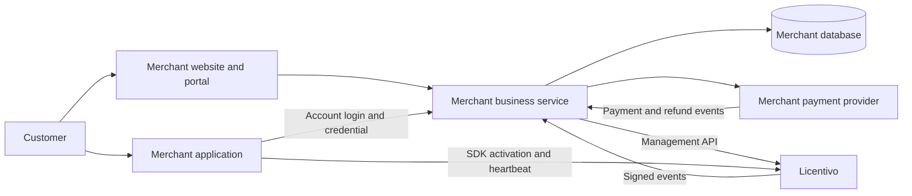

# Licentivo Launch product requirements

Version: 0.2 development baseline

Original baseline date: 2026-10-15

Audience: product owners, software merchants, developers, testers, and deployment operators

This English edition preserves the original requirements and acceptance scope. Requirements describe intended behavior, not proof of implementation. The original single-product scope has since expanded to multiple products. Consult [README](README.md), [progress](docs/progress.md), and the [current management API contract](docs/licentivo-contract.md) for implemented behavior and limitations.

The v0.2.0-beta.1 first-run flow supersedes the original setup concept: the server creates a fixed initial administrator, then requires a password change before granting administration. No setup token is needed. See the [binary installation guide](docs/binary-installation.md).

Launch is an open source, independently deployed software storefront, account, sales, and licensing integration system. A merchant configures its own brand, products, plans, payment accounts, and Licentivo connection. Customers register and purchase on the merchant website, then sign in to the software. The normal purchase flow creates/manages licenses in the background without requiring manual license-key entry.

The goals are faster Licentivo integration and merchant ownership of customer/sales data. Each merchant has an instance and database. This is not a hosted multi-merchant SaaS, and it does not centrally synchronize customer accounts, orders, or contact information to Licentivo.

The selected baseline is Go, GORM, MySQL, and MIT licensing, with Stripe and PayPal and C/C++/C#/.NET/Go/Python integration examples. Existing Licentivo capabilities mean reusable management endpoints/SDK behavior, not completed storefront functionality.

## 1. Confirmed product principles

| Principle | Requirement |
| --- | --- |
| Independent deployment | One merchant per instance with its own domain, server, and database |
| Open source | Source, deployment/upgrade instructions, and editable UI; no proprietary component required for core purchase/licensing |
| Licentivo integration | Reuse existing license, device, signature, heartbeat, and offline capabilities |
| Merchant-owned records | Customer accounts, contact information, orders, and payment relationships stay in the merchant database |
| Data minimization | Send only licensing/runtime data to Licentivo, not customer passwords, contact details, or complete orders |
| Original single-product scope | One software product with plans/account access; no cart or multi-merchant marketplace. Multiple products were subsequently added |
| Account-based access | Purchase through the merchant and automatically retrieve the account's own application credential |
| Staged delivery | M0 design/scaffold, then M1-M3 business workflows |

## 2. Roles and responsibilities

| Role | Responsibilities |
| --- | --- |
| Licentivo provider | Maintain the open source integration, management API, SDKs, docs, and compatibility versions |
| Merchant | Deploy and manage brand, software, plans, customers, payments, refunds, licensing, and local data |
| Customer | Purchase, inspect entitlements, sign in to software, renew/upgrade, and manage owned devices |
| Merchant staff | Operate/support within explicitly granted permissions |
| Payment provider | Process merchant payments and report payment/refund outcomes |

Maintaining the software grants no automatic access to merchant databases. Customers do not need Licentivo platform accounts and must never receive management API keys.

## 3. Goals and initial scope

Core goals: guide a merchant through setup and a test purchase; automatically grant the correct software access after authentication/payment; maintain one consistent license through renewal/upgrade/expiry; support merchant export/backup/restore; and reconcile website, order, and runtime license state.

P0 means required before the initial commercial release, P1 a later enhancement, and P2 longer-term work. Financial reliability, data ownership, and account/license correctness cannot be omitted.

| Priority | Scope |
| --- | --- |
| P0 | Self-hosting, setup, branded site, original single-product/multiple-plan model, email accounts, perpetual/fixed-term purchases, renewal, upgrade, Stripe/PayPal, and full refunds |
| P0 | Licentivo/policy mappings, automatic issuance, account activation, node-locked/floating modes, customer portal, merchant account/order operations |
| P0 | Amount verification, idempotency, jobs/retries/manual recovery, reconciliation, redacted logs, permissions, export, backup/restore, and end-to-end examples |
| P1 | Recurring billing, cancellation, failed-payment notices, additional payment providers, social login, partial refunds, maintenance-term renewals |
| P1 | Multiple products (now implemented), short-lived activation credentials, reduced long-term-key exposure, existing-account-system integrations, additional language account adapters |
| P2 | Coupons, referrals, reseller distribution, teams, custom fine-grained staff roles, advanced reporting |

Fixed-term purchases require deliberate customer payment; automatic charging is not the default. Data models should support future subscriptions. Hosted merchant instances, platform subdomains/settlement, physical inventory/logistics, shared marketplaces, a new cryptographic runtime, centralized customer contacts, all-language account SDK rewrites, and app-store purchases are outside the initial scope.

## 4. Architecture and deployment

Each merchant runs a website, business service, and database. Accounts, orders, webhooks, and management API calls share that service. Database-backed jobs can run in the same executable; a separate broker is not mandatory.

The merchant stores customer identities, orders, and account/license mappings. Licentivo stores product/policy/license/device/runtime records. Payment-provider data is limited to payment processing; it is separate from Licentivo platform wallets/billing.

## 5. Merchant setup and integration

The setup journey covers deployment checks, administrator, branding, licensing, software/plans, payments, and acceptance. Saved steps survive failures and can resume.

| ID | P0 requirement and acceptance |
| --- | --- |
| SETUP01 | Check database, HTTPS, email, writable data, and workers; show actionable failures before live payment |
| SETUP02 | Create administrator once and close initialization against repeated takeover |
| SETUP03 | Configure merchant name/logo/content/contact/domain; use its branding on site/email |
| SETUP04 | Validate the Licentivo key and workspace permissions; current implementation fixes the service origin |
| SETUP05 | Select existing products/policies or explicitly confirmed creation; retries do not duplicate products |
| SETUP06 | Configure versions, public keys, downloads, and plans; complete test login/purchase/issuance/activation |
| SETUP07 | Separate test/live payment credentials and records; tests cannot become real revenue/access |
| SETUP08 | Present release checks, key-expiry information, callback status, and backup reminders |

Target, not a measured claim: with domain/database/email/payment prerequisites ready, documentation should enable a first test purchase and activation within 30 minutes.

Store connection secrets encrypted on the merchant server. Verify new credentials before rotating workers to them. Show connection/permission/known expiry information; allow an operator reminder if expiry cannot be read. Require valid product/policy/version mappings and compatible device/heartbeat/offline/features. Do not mix merchants/products or trust client-supplied management keys/license IDs. A licensing outage preserves confirmed orders and tasks for later recovery.

Provide account endpoint, public product configuration, SDK public keys, compatible versions, and call-site guidance. Deliver C/C++/C#/.NET/Go/Python desktop and Web backend examples. Distinguish modern .NET from unverified .NET Framework. Describe existing upstream SDK parameter integration without claiming that all nine SDK languages have new account-login wrappers.

Examples must eventually cover registration, purchase, credential recovery, restart, denial, renewal/upgrade, and account switching. Installers contain public configuration only, without administrator keys, customer licenses, test secrets, or development cache.

## 6. Customer website and accounts

| ID | P0 storefront requirement |
| --- | --- |
| SITE01 | Product summary, features, screenshots, requirements, installers, and merchant support |
| SITE02 | Plan price/currency/term/features/devices/seats/offline/maintenance meaning |
| SITE03 | Choose one plan and check out directly, without a shopping cart |
| SITE04 | Show the current plan and purchase/renew/upgrade actions after login |
| SITE05 | Desktop/mobile usability and merchant branding; original baseline bilingual, current customer site ten locales |
| SITE06 | Explain automatic account access and distinguish installing software from buying its license |

Support email/password registration, verification, login/logout, password recovery/change, and session inspection/revocation. Store password hashes, verification tokens, and sessions in the merchant database; use merchant-configured email.

Use the same merchant identity on website/software without a Licentivo account registration step. Rate-limit registration/login/recovery and avoid account enumeration. Purchases require a verified authenticated account and preserve a pre-login plan selection. Enforce ownership of orders, entitlements, devices, and downloads. Email changes verify the new address without losing mappings. Disabled accounts cannot obtain new sessions/activations and must synchronize suspension. Account closure must explain outstanding rights/orders and required financial/audit retention.

The portal includes products, plans, orders, devices, and account settings. Ordinary pages show rights/term/state rather than requiring license-key manipulation.

| State | Customer presentation |
| --- | --- |
| Active | Plan, expiry, features, device/seat limit, launch/download action |
| Not purchased | Eligible plans and any merchant-enabled trial |
| Payment pending | Amount/status and query action |
| Paid, licensing pending | Confirmed payment, processing/retry/support information; never ask to pay again |
| Expired | Deadline, renewal action, unavailable features |
| Device limit reached | Owned device list, allowed release action, support |
| Suspended | Safe reason category/support without internal errors or secrets |

Perform self-service device actions through merchant-authenticated APIs. Do not default customers to an upstream portal requiring disclosure of their real email.

## 7. Merchant administration

| Module | P0 scope |
| --- | --- |
| Overview | Captured/refunded/net amounts by currency, active/pending/expired customers, licensing failures; test data separated |
| Website | Branding, product descriptions, downloads, plans, support |
| Products/plans | Price/term/publication and one policy selector; synchronize full licensing settings into versions; draft/test/publish |
| Customers | Customer-only search, orders/rights/devices/sync status, reasoned disable/restore |
| Orders | Payment/issuance/renewal/upgrade/refund states, safe errors, close unpaid orders, authorized refunds |
| Licensing | Associations, terms/features, retry/compensation, suspend/restore, device release |
| Integration | Connection, public keys, callbacks, compatible SDKs/examples |
| Jobs/reconciliation | Events, failed tasks, uncertain payment, remote differences, original-operation retry |
| System settings | Collapsible staff/email/payments/licensing/export/backup sections; staff creation and roles |

Routine price/publication changes must not require source edits. New application features still require application development; administration configures existing feature identifiers.

Administrators have full authority. Operators manage products/read orders; support handles permitted customer/device issues. Secret settings, refunds, permanent revocation, export, and administrator management require explicit permissions and audit.

## 8. Products and plans

| Category | Fields/rules |
| --- | --- |
| Identity | Local plan/product ID, name, description, version |
| Presentation | Order, recommendation, feature comparison, new-purchase/renewal eligibility |
| Price | Currency, integer minor units, price version, provider eligibility |
| Purchase type | Perpetual/fixed term initially; subscription/maintenance later |
| Term | Start rule, duration or explicit period end, trial restrictions |
| Licensing | Remote product/policy/version and node-locked/floating mode |
| Rights | Feature IDs, devices/seats, usage quota, version/maintenance rules |
| Upgrade | Allowed targets, rights change, effective time, price difference |
| Offline | Summary synchronized from the selected licensing policy |

One principal current entitlement/license association exists per account/product/payment environment, with history retained. The original one-product launch scope has expanded; product isolation remains mandatory.

Draft before publication. New prices/rights create new versions; orders retain immutable purchase snapshots. Archive stops new sales without cancelling paid rights, with independent renewal eligibility. Explain the impact of upstream policy changes on old licenses; prefer a new policy to silently editing a shared active one. Display names may be localized; programmatic feature IDs remain stable.

## 9. Purchases, payments, and refunds

| ID | P0 rule |
| --- | --- |
| PAY01 | Server calculates price/currency/plan/rights; ignore client prices |
| PAY02 | Snapshot user/product/order/environment/provider/price/rights at creation |
| PAY03 | Show amount/term/rights/effective rule and explicit no-autocharge status for fixed terms |
| PAY04 | Duplicate clicks/retries recover the same operation; refresh does not resell existing access |
| PAY05 | Close unpaid orders, but retain and reconcile late real payments |
| PAY06 | Verify signature/source/environment/merchant/status/amount/currency/order |
| PAY07 | Grant only after trusted captured payment, not return pages/screenshots/authorization alone |
| PAY08 | Commit payment fact and licensing task before acknowledging; remote failure cannot undo a payment |
| PAY09 | Query provider state for missing, out-of-order, or uncertain results |
| PAY10 | Give customer/support/admin a consistent traceable payment/access status |

Use integer minor units and validate each currency's precision. Aggregate currencies separately. Deduplicate transaction/event IDs within payment-account scope. Repeated events never charge, issue, extend, or increase quota again. Arrival time is not state precedence; query current provider state when needed.

Funds go directly to merchant-configured payment accounts. Do not collect software payments through Licentivo platform wallet/top-up/plan APIs. Both Stripe and PayPal must independently pass payment/query/webhook/refund tests. Do not advertise unfinished adapters as accepted. WeChat Pay/Alipay and app-store purchases are outside the initial scope. Customers return to the merchant, without visiting a Licentivo administration console.

The automatic flow is authenticated plan selection, server order creation, verified payment, local coverage/task commit, remote license create/update, successful local association, then application login/activation. During an outage show paid/pending and retry; active status requires both successful remote work and local binding.

P0 refunds include customer request, merchant review, full original-channel refund, queries, and events. A request/button click is not refund success. Bind to the original payment and enforce captured-minus-refunded balance. Query ambiguous results rather than creating another refund. Recalculate coverage after trusted success, preserving other legitimate paid periods and base rights after an upgrade refund. Use recoverable suspension for loss of rights; permanent revocation is explicit and terminal. Disputes need verified manual review. Offline signed grants expire according to their policy; do not promise instant revocation of every offline machine.

## 10. Terms, renewal, and upgrades

Fixed terms start at verified payment, not first application launch. Perpetual software has no usage deadline; maintenance/version rights are separate.

| Type | Rule |
| --- | --- |
| Perpetual | Paid rights continue; maintenance expiry does not automatically stop an already permitted version |
| Days | Explicit number of days from payment, with an exact deadline |
| Calendar months/years | Preserve contract anchor; clamp to the last valid day without future anchor drift |
| Trial | Start at redemption or a defined first-use event; one default trial per account/product |
| Future subscription | Use trusted provider-paid period boundaries rather than locally adding periods again |

Thirty days differs from a month. Preserve a January 31 anchor across February. Evaluate in server UTC and show comprehensible timezone information. Current Licentivo activation-based duration differs from sales deadlines; use the documented adapter limitations rather than claiming absolute alignment merely by sending days.

For an unexpired plan, renewal extends from the current end; for expired rights, start at the new verified payment. Keep the same account/license, activation/device/history. Apply each payment once. Show price and resulting expiry before purchase. Archived-but-renewable plans are limited to eligible existing customers. New payment cannot automatically clear misconduct/manual suspension.

P0 self-service upgrade uses the same currency, purchase type, and license mode. Reducing devices, changing node-lock/floating mode, or perpetual/fixed type requires conflict-aware administrator handling. Show current/target rights, amount, effective time, and deadline. Preflight remote conflicts before collecting payment.

Fixed-term upgrades preserve the paid period end and prorate the same-period price difference over remaining time with deterministic integer rounding upward. Do not silently convert currencies/periods or grant a free full period. Perpetual upgrades use a merchant-defined fixed difference. Bind an expiring quote to current entitlement version/target snapshot; requote after changes. Retain license/device/metering history and explain new-quota behavior. Recover a failed post-payment change without another charge. Downgrade is P1, normally next period with explicit excess-device/quota handling.

Future subscriptions advance coverage only after trusted renewal payment. Cancellation retains the paid period, failures enter a defined overdue/grace state, and recovery reconciles the current period instead of replaying old rights.

## 11. Software login and automatic licensing

The first desktop integration can use the existing SDK license input/device credentials. Launch stores encrypted per-customer keys and supplies only the authenticated account's product credential. This is not a shared installer key. Do not place complete keys in public pages, email, URLs, browser storage, or logs. Prefer restored SDK device credentials after activation.

| ID | P0 application requirement |
| --- | --- |
| APP01 | Authenticate against the merchant; do not send passwords/sessions to Licentivo |
| APP02 | Server verifies account/product/coverage/sync, not client-claimed plan |
| APP03 | First activation/new account/device requires online authenticated access |
| APP04 | Reuse SDK identity/signature/activation/heartbeat/feature checks |
| APP05 | Private cache scoped to account/product/device; no cross-account reuse |
| APP06 | Restore valid signed credentials after restart without repeated key entry |
| APP07 | Explicit logout closes SDK and clears scoped local login/cache; normal close and device release remain distinct |
| APP08 | Confirmed disablement denies the next successful online validation; offline grants follow expiry |
| APP09 | Reauthentication can retrieve the account's own credential after local loss |
| APP10 | Check protected actions with SDK; use reserve/confirm/cancel for metered work |

If browser login is used, bind its callback to the initiating application instance with one-time authorization and verifier state. P1 short-lived activation credentials require a new contract and SDK validation; device-transfer codes are not generic first-login credentials.

Web products validate account rights in trusted server code. Define synchronization freshness and outage handling. Do not represent every customer's device with one server machine ID; Web account rights and desktop machine binding differ.

Node-locked mode limits registrations; floating mode limits simultaneous seats. The reviewed baseline requires floating heartbeats of at least 600 seconds and a lease greater than heartbeat + rounded-up 10% + 30 seconds. Floating grants cannot outlast the seat lease and require an online seat at startup. Fixed offline windows start at the latest successful validation, never at network disconnection, and cannot outlast license validity. Heartbeat/offline choices are independent and invalid combinations must be explained. Device release verifies ownership and preserves paid rights/metering history.

## 12. State and recovery

| Object | States and invariant |
| --- | --- |
| Order | Pending, closed, paid, refund pending, refunded; paid is an immutable funds fact |
| Payment | Creating, pending, successful, failed, uncertain; query uncertainty rather than create another payment |
| Licensing task | Pending, running, retrying, complete, needs attention; verify/recover uncertain remote outcomes |
| Local entitlement | Pending, active, expired, suspended, revoked; check time, coverage, account, and sync |
| Remote license | Active, suspended, revoked, derived expiry; permanent revocation cannot be automatically undone |
| Future subscription | Active, cancel-at-period-end, overdue, ended; cancellation retains paid rights |

Atomically save payment/order/task state. Workers claim leases, call remote APIs with stable IDs, and store results. Restarts/retries reuse original IDs/parameters.

| Failure | Required recovery |
| --- | --- |
| Paid but event missing | Query the original transaction and record it without asking for another payment |
| Licentivo timeout | Show processing; query/replay the original idempotent request |
| Remote success, local save lost | Recover the same result/key and binding |
| Concurrent purchase/upgrade | Serialize by account/product, checking current versions |
| Out-of-order event | Check transaction/current entitlement; old state cannot overwrite a new plan |
| Upstream manual change | Verify signed event/reconcile; retain manual restrictions and terminal revocation |
| Expired/invalid key | Retain payment/tasks, stop ineffective retry loops, notify administrator |
| Persistent task failure | Show impacted account/order and provide audited retry/compensation |

Reconcile provider transactions, merchant ledger, and Licentivo state periodically and on demand without clearing legitimate manual disablement.

## 13. Customer data ownership and transmission

| Data | Merchant instance | Licentivo | Payment provider |
| --- | --- | --- | --- |
| Email/name/phone/contact details | Merchant-controlled storage | Not sent by default | Only fields necessary for payment |
| Password hashes, verification, sessions | Stored locally | Not sent | Not sent |
| Order lines/prices/refunds | Full history | No complete order | Payment/refund processing data |
| Account/license mapping | Full association | Opaque reference only | Not a licensing database |
| Product/policy/license/rights/validity | References and snapshots | Licensing records | Purchased item information only |
| Device/application/runtime metadata | Customer-management summary | Needed licensing metadata | Not sent |
| Sensitive card details | Not directly stored by Launch | Not sent | Provider-managed |
| Site analytics | Local or merchant-selected service | Not automatically synchronized | No default analytics role |

Device identifiers and IPs can be linkable runtime data. Data minimization must not be advertised as no end-user data ever reaching the licensing service.

Use random customer references, not `customer_email` or encoded/hashed contact information. Scope references per instance/account/product. Keep the mapping local. Generic device names should not reveal account/name; personal notes stay local. Document device/hardware/virtual-machine metadata according to policy. Do not leak contacts or credentials through support logs, export, or task parameters. No default customer profiling, forced telemetry, or remote merchant-database access. Merchants choose and redact diagnostics.

Export accounts/orders/refunds/plans/rights/bindings/device summaries/audit with IDs, timestamps, currency, and versions. Ordinary CSV excludes hashes, sessions, management/payment secrets, and complete license keys. Full recovery uses a separate encrypted backup including records and decryption material, with necessary filesystem uploads/configuration retained separately. Customers can only export their own records. Contact deletion and required financial/license retention are separate decisions. Merchants retain local data after leaving the software; new online activations remain subject to their Licentivo service and existing offline grants.

## 14. Licentivo API baseline and required compatibility

Original source-review baseline: 2026-10-14. Freeze and contract-test actual deployed API/SDK versions. Reusable upstream behavior is not proof that the entire Launch workflow exists.

| Capability | Existing endpoint/component | Integration rule |
| --- | --- | --- |
| Products/policies | `/api/v1/products`, `/api/v1/policies`, policy capabilities | Merchant-owned product/policy/version mapping |
| Issuance | `POST /api/v1/licenses/batch`, `create` | Stable request ID; recover rather than blindly recreate |
| License state | License read/capabilities endpoints | Verify state, term, rights, and consumed quota |
| Renewal | Ordinary renewal and batch `renew` | Calendar sales coverage is local; prefer recoverable batch semantics |
| Policy change | `policy-preview`, batch `apply_policy` | Preflight devices/version and recheck duration effects |
| Suspend/resume/revoke | License PATCH and explicit revoke | Distinguish recoverable suspension from terminal revocation |
| Devices | Activations list/release | Verify account ownership before management calls |
| Versions/maintenance | Product version/maintenance endpoints | Separate allowed versions from runtime validity |
| Events | Webhooks and delivery records | Verify, deduplicate, and reconcile |
| Runtime | Activation/validation/heartbeat/release and upstream SDKs | Reuse identity, signatures, cache, offline/floating rules |

Batch creation retains encrypted results, enabling recovery of the original license key by original request. Save both operation ID and parameters locally and encrypt keys with the merchant's own key. Do not assume arbitrary old keys can be retrieved in plaintext later.

| Gap | Baseline difference | Required outcome |
| --- | --- | --- |
| GAP01 | Activation-based policy duration instead of absolute sales deadline | Correct contract coverage before/after activation; current adapter uses local deadlines and remote suspension |
| GAP02 | Policy changes can recompute expiry | Upgrade rights without unintended paid-period changes |
| GAP03 | Remote management and local payment cannot share a transaction | Explicit idempotency/query/timeout recovery |
| GAP04 | Ordinary updates lack sales-version checks | Stable operations and local version/serialization protection |
| GAP05 | Email-based upstream portal/device release differs from local ownership/quota | Merchant identity checks and idempotent self-service limits |
| GAP06 | Runtime SDK lacks Launch merchant login | Account authentication, own-credential retrieval, scoped caches, examples |

Fixed-term/upgrade acceptance depends on resolving or explicitly documenting GAP01-GAP04. A local professional-plan flag/deadline cannot substitute for the SDK's actual remote rights. The current adapter strategy and deadline/outage limitation are in [licentivo-contract.md](docs/licentivo-contract.md).

The original proposed richer synchronization contract is a design requirement, not an existing API: stable operation ID, target/reference, expected entitlement version, absolute validity, feature/seat snapshot, allowed transition, and applied version/state/validity response. Same-ID/same-parameters replays return the same result; changed parameters conflict; older versions cannot overwrite newer ones; grants cannot exceed absolute validity; metering/device generations remain; requests stay within the management key's merchant/product scope. Do not transmit contacts, complete orders, card data, or sale amount as licensing inputs. Final endpoint/field/version designs require OpenAPI and SDK contract tests.

Payment and licensing events use separate addresses, keys, and deduplication records. Licentivo signatures cover timestamp, event ID, and raw body. Verify raw bytes before JSON reserialization. Handle frozen-version `X-Licentivo-*` and explicitly supported legacy `X-Licenova-*` headers; branding does not imply protocol unification. Unverified events never change state. Verified events are persisted and recovered rather than dropped on business failure.

## 15. Local data model

Models serve one merchant, without platform merchant onboarding, tenant billing, or tenant switching.

| Object | Contents and constraints |
| --- | --- |
| Merchant configuration | Brand/domain/email/licensing/encryption/payments; encrypted secrets and recoverable keys |
| Product | Description/download/remote product/public keys/version; stable IDs |
| Plan/version | Type/price/currency/term/rights/mapping; immutable published history |
| Customer account | Contact/verification/disable reason; local identity, not upstream email identity |
| Website/software session | Account/source/expiry/revocation; never passed to Licentivo |
| Order | Account/product/action/price/rights snapshot; unique number and immutable transaction facts |
| Payment/refund | External ID/environment/provider/amount/result; deduplication and refund balance |
| Paid coverage | Period/plan/source order; never duplicated by replay or first application launch |
| Future subscription | Provider ID/paid period/cancel/renewal; only trusted payment advances coverage |
| License binding | Account/product/remote ID/version/encrypted key; one current principal binding, history retained |
| Device summary | Remote ID/note/state; traceable ownership |
| Self-service operation | Account/device/operation/quota window; retry does not consume quota twice |
| Event | Provider/type/ID/body hash/result; separate deduplication and bounded encrypted retention |
| Synchronization task | Order/target version/stable ID/parameters/retry/result; recoverable original operation |
| Audit/reconciliation | Actor/object/reason/difference/resolution; no plaintext secrets |

Quotes and settlement use paid coverage and committed snapshots, not today's price to reconstruct history. Transactions and constraints jointly enforce correctness under concurrency/replay/restart.

## 16. Pages and API scope

| Audience | P0 pages |
| --- | --- |
| Visitor | Product/plans/register/login/verification/recovery/download/support |
| Customer | Rights, checkout/result/order, renewal/upgrade, refund request, devices, account/sessions |
| Administrator | Setup/overview/content/products/plans/customers/orders/refunds/licensing/jobs/reconciliation/settings/staff/export/backup |
| Software | Login, pending/active/expired/device-full/offline, logout, explicit deactivation |

Payment-result pages can be refreshed/revisited from another authenticated browser. Ordinary customer UI should not expose internal job IDs, database fields, remote keys, or raw internal errors.

Required API capabilities: website authentication/verification/reset/sessions; software authentication/callback/own rights/credential; catalog/order/payment/query/renew/upgrade/refund; customer rights/orders/devices/downloads; administrator content/customers/transactions/jobs/settings/export; separately verified payment/license events; readiness/job/schema/compatibility status.

Exact routes belong in a maintained OpenAPI. Responses use understandable state, business codes, and request IDs. Publish permissions/limits/errors/retry rules so integration does not require reading internal server code. The current system-endpoint subset is incomplete.

## 17. Security and permissions

1. Enforce account/role/object authorization on every read and action.
2. Use a mature slow password hash and revocable credentials/sessions; protect high-risk administrator operations with appropriate identity controls.
3. Use HTTPS for public account/software/callback/licensing traffic and CSRF protection for cookie-authenticated writes.
4. Encrypt management/payment/email/license secrets and exclude them from logs, responses, export, and assets.
5. Separately verify event signatures/replay windows/body size; public callbacks cannot invoke arbitrary administration.
6. Rate-limit authentication, recovery, credential, and payment queries; use bounded retry/backoff.
7. Restrict file/download/remote targets to intended scope and prevent configuration-based unrelated internal-network access.
8. Enforce paid business actions through SDK or trusted server rights, not client booleans/UI state.
9. Audit manual grant/suspend/restore/refund/revoke/sensitive export with actor/reason/object/change.
10. Preserve financial/order history; correct with explicit records, not overwritten sale amounts.
11. Isolate test/live/demo data and credentials; public demos cannot use real customer data or live payment accounts.
12. Public packages must exclude real deployment secrets, customer databases, and private backups. The documented initial administrator password is restricted to first-login password replacement and must be changed before administration is available.

These controls support data and transaction correctness. They do not claim that clients cannot be modified or that long-offline devices can be revoked instantly.

## 18. Deployment, operations, and upgrades

Provide direct binary and Compose instructions. The stack is Go/GORM/MySQL with embedded assets. Models define schema and AutoMigrate at startup; no separate schema SQL is required. Each instance has its own database/master key/administrator/payment/licensing accounts. Original production target is Linux, with Windows-first desktop examples; publish actual platform verification.

No hosted controller/shared customer database/remote configuration service is required. Document email, data paths, domain, database, payment configuration, resources/ports/dependencies, and compatible API/SDK versions.

Persist job state and support leases/retries/restart/stale-task recovery. Show payment events, pending licenses, backlog, invalid keys, licensing connectivity, email failures, and backups. Send safe administrator alerts for meaningful failures.

Back up records/files/configuration/decryption material and rehearse restore. Verify accounts/history/decryption/jobs/bindings. Reconcile provider/license events after the snapshot before resuming to avoid lost payments or duplicate refunds/renewals. Document schema compatibility and rollback conditions; irreversible changes require a restore plan. Preserve incoming events across upgrades. Uninstall/version changes must not silently delete business data.

Proposed recovery targets are RPO <=24 hours and RTO <=2 hours, subject to real drills. Provider reconciliation must restore payment facts; these targets do not permit financial history loss.

## 19. Experience and performance acceptance targets

| Area | Target/test boundary |
| --- | --- |
| Merchant setup | First test purchase/activation within 30 minutes after external prerequisites |
| Access after payment | 95% of licensing jobs within 30 seconds when dependencies are healthy; accurate pending state otherwise |
| Event intake | Verify/persist before acknowledgment, without blocking on remote licensing; target P95 <=2 seconds |
| Local reads | Proposed 2 CPU/4 GB, 10,000 accounts, 50,000 orders, 20 requests/sec, P95 <=500 ms excluding upstream latency |
| Mobile | Core account/purchase/query/device tasks at width 360 without obstructed controls |
| Accessibility | Labels, locatable errors, announced state, keyboard operation |
| Correctness | No duplicate charge/grant under replay, timeout, restart, or concurrent purchase |
| Data ownership | Traffic/log review confirms no passwords/contacts/complete orders sent to Licentivo |
| Outage | Recoverable paid/pending orders; existing software follows only valid signed offline rules |

These are acceptance goals, not measured guarantees. Release notes must state actual environments/results/limits.

## 20. Open source distribution and deliverables

Launch is separate from the licensing service; merchants need not deploy Licentivo's full platform administration. Include storefront/account/admin/orders/payment/licensing/jobs/deployment source. No separately purchased proprietary connector is required for core flows; external services retain their fees/terms. Keep Licentivo as the official licensing backend, allow merchant branding/customization, preserve notices, and avoid forced telemetry/remote database access. The project's MIT license does not relicense third-party dependencies.

| Deliverable | Required contents |
| --- | --- |
| Source | Buildable service/UI/jobs and traceable versions/dependencies |
| Release/container | Versions/checksums/configuration/Compose/health/data paths |
| Installation/upgrade guide | First setup/domain/TLS/email/payments/licensing/public keys/backup/schema |
| Merchant guide | Plans/prices/support/renewal/upgrade/refund/licensing/export |
| Integration guide | Merchant authentication/own credential/SDK/cache/restart/logout/offline |
| Examples | Desktop/Web examples and upstream SDK parameter guidance |
| API | Current routes, permissions, errors, retries, events, compatibility |
| Acceptance record | Payments/licensing/concurrency/recovery/minimal data/restore |
| Demo | Synthetic data/test payments, clearly distinguished from real transactions |

## 21. Complete acceptance scenarios

All P0 scenarios must pass before the commercial purchase/automatic-licensing release. Use provider sandboxes and isolated Licentivo products; do not create test customers or real charges in production demonstrations.

| ID | Scenario | Expected result |
| --- | --- | --- |
| AC01 | Fresh setup | Own administrator/workspace/plans; initialization closed |
| AC02 | Read-only/wrong/expired key | Clear safe failure; write tests/publication blocked |
| AC03 | Register/verify/login/recover/change email | Correct account and retained rights; local data |
| AC04 | Publish base/pro plans | UI matches configuration and order snapshots |
| AC05 | First payment and application login | One automatic license/binding and activation; no manual key |
| AC06 | Ten duplicate payment events | One payment/order/current binding and no duplicate term/quota |
| AC07 | Remote issuance success before local crash | Same license/key recovered after restart |
| AC08 | Licensing outage during payment | Paid/pending retained; eventual recovery without another charge |
| AC09 | Missing payment event | Query original transaction and grant once |
| AC10 | Tampered price/plan/amount | Reject invalid input; use trusted price/payment facts |
| AC11 | Delayed first software launch | Paid contract end is preserved, not restarted |
| AC12 | Renewal before/after expiry | Continue current end or start at new payment; apply once |
| AC13 | Month-end/leap-year/timezone | Correct calendar anchors, distinct from 30 days |
| AC14 | Base-to-pro upgrade | Correct difference, same period end, retained usage history |
| AC15 | Rights change while quote pending | Reject/requote stale version |
| AC16 | Initial/renewal/upgrade full refunds | Deduplicate, recompute coverage, retain lawful base rights |
| AC17 | Unpaid/failed/invalid signature | No access from a return page or invalid event |
| AC18 | Cross-account object access | Reject orders/credentials/devices without data leakage |
| AC19 | Close/restart/logout/switch | Restore own state; clear scoped logout state; no cache mixing |
| AC20 | Device full and self-release | Safe explanation/ownership; retry consumes quota once |
| AC21 | Invalid floating/offline/lease | Reject incompatible settings; valid seats acquired/released |
| AC22 | Valid offline cache then expiry | Honor valid grant; deny after signed/contract deadline under documented enforcement limits |
| AC23 | Disabled account/suspended license | Deny new activation/next online validation, without instant-offline claims |
| AC24 | Duplicate/out-of-order event/manual revoke | Reconcile once; old payment cannot undo revocation |
| AC25 | Price/archive/shared policy changes | Preserve snapshots/rights and explain eligibility/impact |
| AC26 | Traffic/log/assets/export/email review | No public secrets/passwords; no contact/full-order upload to Licentivo |
| AC27 | Restore on another host | Decrypt/recover history, reconcile subsequent payment, no duplicate financial action |
| AC28 | Upgrade/restart jobs | Preserve accounts/orders/bindings/events and compatibility |
| AC29 | Two independent merchants | Separate data/keys/funds, without platform onboarding |
| AC30 | Change price/add plan without code edits | Draft/test/publish with auditable pricing/mapping |

P1 subscription acceptance separately covers deduplicated renewals, paid cancellation period, expiry, failed charging, recovery, scheduled downgrade, plan changes, and partial refunds. Short-lived activation credentials need purpose/product/device/expiry/one-time/concurrency checks.

## 22. Delivery stages and release gates

| Stage | Focus | Gate |
| --- | --- | --- |
| M0 | Scope, contracts, two providers, examples, MIT, scaffold | Document GAP01-GAP04 strategy/compatibility; real upstream acceptance remains M2 work |
| M1 | Setup/brand/accounts/admin/plans/connection and simulated payment | Verify snapshots, permissions, data boundaries |
| M2 | Both payment sandboxes, issuance/term/recovery, desktop/Web examples | Normal and interrupted purchase/activation across agreed languages without manual keys |
| M3 | Renewal/upgrade/refund/devices/reconciliation/export/backup/upgrade | P0, performance, deployment drills, and complete source/docs |
| M4 | Subscription, short activation, additional providers/products/languages | Independent P1 acceptance without rewriting existing purchased rights |

Estimate time/resources after integration boundaries are clear. Clickable screens do not replace real payment and recovery tests.

## 23. Review decisions

Independent deployment, merchant data ownership, and Licentivo integration are confirmed. The baseline selected Stripe/PayPal, payment-start fixed terms, perpetual/fixed purchase before subscriptions, C/C++/C#/.NET/Go/Python/Web examples, Go/GORM/MySQL/embedded assets, and MIT.

The original single-product scope was a planning choice, subsequently expanded. Finalize absolute-validity/version/idempotency compatibility before the corresponding release. Merchant policy determines offline windows; publication must explain delayed offline revocation. Merchant branding takes priority, with configurable placement of licensing attribution. Defaults and compatibility must be reviewed before plan publication.

## 24. Source evidence and current references

The original requirements reviewed a separate Licentivo server workspace covering management routes, license creation/update/renew/suspend/revoke, batch replay/policy preview, capabilities, runtime signatures, webhooks, device/transfer credentials, and SDK startup. That workspace is not distributed here and those historical paths are not public repository links.

Public implementation references in this repository:

- [Licentivo adapter](internal/adapters/licentivo/client.go)
- [HTTP routing and assets](internal/httpapi/server.go)
- [Application routes](internal/httpapi/application.go)
- [Database models](internal/storage/models.go)
- [Go account client](pkg/launchclient)
- [Integration examples](examples/README.md)
- [Current management contract](docs/licentivo-contract.md)
- [Licentivo website](https://www.licentivo.com/)

Validate deployed API/SDK versions against actual upstream documentation and acceptance tests rather than inferring compatibility from this historical specification.
