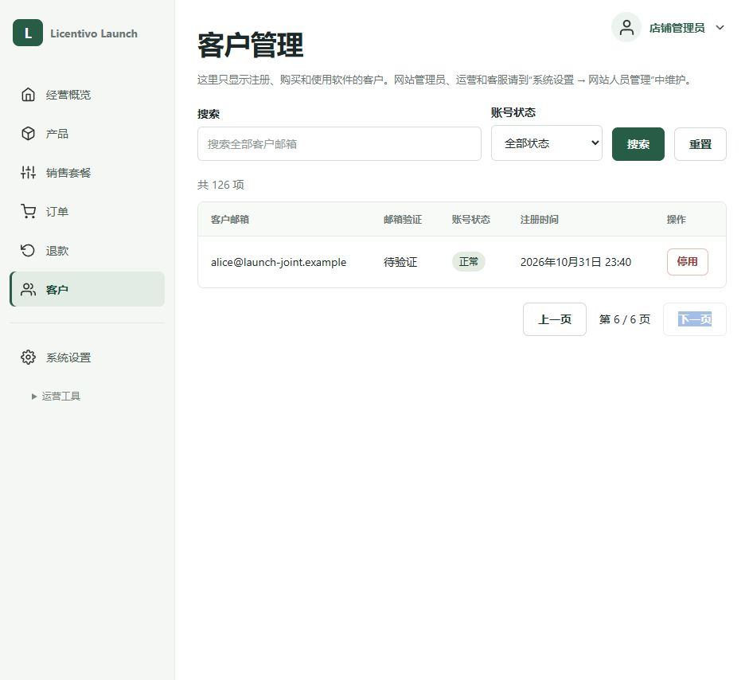
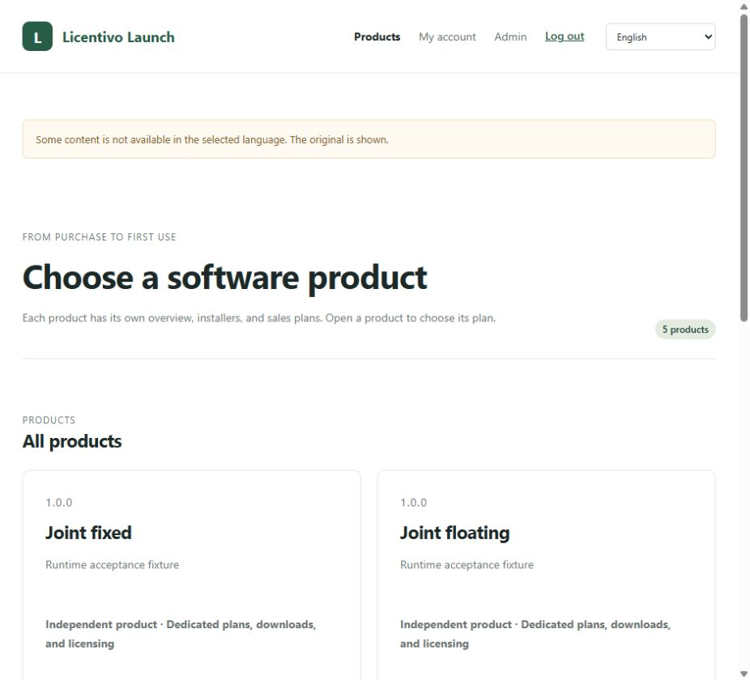

# Launch 修复及联合回归结果 · 2026-11-01

> 后续更新：本文记录当时的修复验收。其余八种语言的续期实现现已同步，九种语言在 177 通过 920 秒真实业务回归。见[SDK 更新与长任务联合回归](launch-sdk-renewal-regression-2026-11-01.md)，原始测试边界及证据保留如下。

已完成本人负责的 N01、N02、N03、N05、N06、N07、N08，并同步另一个 AI 完成的 Licentivo N04、N09（Python）修复，在 177 上做了配套回归。下表内的具体复现场景均通过。这个结论不代表所有平台、所有语言的所有长任务都已验收。

联合环境在北京时间 **04:20:20** 更新；真实长任务在 **04:21:42–04:36:48** 运行。本轮是修复后的定向回归，**没有重新运行四小时 soak**；此前四小时测试及原始缺陷仍保留在 [原联合测试报告](test-report-joint-2026-11-01.md) 中。

## 九项问题的结果

| 编号 | 责任范围 | 修复与实际验证 | 结果 |
|---|---|---|---|
| N01 | Launch 前端、设备视图契约 | 明确显示“授权连接”和连接编号，说明一台电脑可以有多个浮动实例，释放只作用于当前连接；同一硬件识别码的两条实际浮动连接没有被错误合并，释放一次仅扣一次释放额度，另一实例仍可运行 | 通过；没有声称能统计物理电脑数量 |
| N02 | Launch 内置十种语言文案 | 缺译文提示改为“暂无译文，显示原文”，不再声称正在生成；未配置翻译服务的真实英文页面已检查 | 通过 |
| N03 | Launch 路由 | 相同 hash 也触发页面渲染；未登录直接访问 `#/admin`、`#/account`，登录后立即显示概览或账号页，地址不必变化，旧登录表单数量为 0 | 通过，依据真实浏览器 DOM |
| N04 | Licentivo 官方 Python SDK，由另一个 AI 修复 | Linux 原生 fork 实测：继承父进程 Client 的两个子进程均拒绝执行；各自新建 Client 后争抢同一任务，只有一个进程进入业务，另一进程得到锁占用；再次恢复同一任务不重跑，原提交回执扣量 1 | 通过 |
| N05 | Launch 设备操作错误映射 | 相同释放请求重试返回同一操作；换目标仍复用同一 operation ID，Launch 和 Licentivo 均返回 `409 IDEMPOTENCY_CONFLICT`，不再伪装成临时不可用；保留关联请求号 | 通过 |
| N06 | Launch SDK、接入提示、文档 | 九种语言的 Application 均增加计量执行和已知结果结算入口；继续使用登录时的官方 runtime；自定义适配器不支持时明确拒绝。九个真实小程序各执行同一计量任务两次，业务只运行一次；独立查询数据库确认九条一单位 committed 记录 | 通过；长任务语言边界见下文 |
| N07 | Launch 客户订单 | 新增完整历史分页接口和页面搜索，统计使用服务器总数；真实页面 120 条订单、每页 25 条，第 5 页 20 条，下一页禁用，第 5 页旧订单按编号可找到一条；MySQL 集成测试覆盖客户隔离、稳定排序和参数边界 | 通过 |
| N08 | Launch 客户管理 | 新增完整客户分页、邮箱包含搜索、状态筛选；真实页面 126 个客户，第 6 页仍能找到 Alice，邮箱查询返回 1 条；排除网站人员，权限和公开字段在 MySQL 测试中验证 | 通过 |
| N09 | Licentivo 服务端与官方 Python SDK，由另一个 AI 修复 | 默认预占约 900 秒未改动，真实业务超过 15 分钟，产生 903 行 CSV，自动续期 15 次，始终使用同一预占；服务器用量从 6 变 7。恢复进程、获取新身份后重试及显式结算，业务回调仍只有 1 次、日志 committed | Python 场景通过 |

N01 没有使用截断的硬件识别码猜测物理设备归属。上游设备接口缺少可安全用于合并的完整物理标识，因此本次修复的是准确呈现连接数量和释放范围。

## 实际执行的回归

- **10 个 HTTP/MySQL 集成测试通过**，使用独立新建 `launch_test_nfixa1101_*` 测试库。新用例额外建立 107 条本人订单、1 条他人订单、126 个客户及 1 个网站人员，检查第 100 条之后的记录、总数、同时间排序、客户隔离、状态筛选、SQL 通配符字面搜索、越界和非法参数。
- **65 个前端逻辑测试通过**；真实浏览器检查补充了相同 hash 登录、120 条订单、126 个客户、旧记录搜索和缺译文提示。分页不是只对浏览器已下载的前 100 条做过滤。
- **九种语言的 18 个真实生命周期场景通过**：固定与浮动授权各一轮，覆盖登录、受保护文件写入、无权限功能拒绝、关闭后恢复、退出后拒绝恢复，以及没有权益的 Bob 被拒绝。
- **九种语言各一笔真实计量业务通过**：同一 operation ID 调用两次并结算，回调只执行一次。独立数据库核对得到九条 committed 记录，每条 quantity=1。
- **SDK 的 18 个构建及测试步骤通过**，涵盖 Go、Python、JavaScript、Java、C#、Ruby、Rust、C/C++；Linux 的 Python 包测试有 1 个 Windows DPAPI 用例按平台跳过，已在 Windows 单独补跑通过。
- **官方 Python 计量任务回归**：Linux 10 项全部通过，包括两项原生 fork；Windows 为 8 项通过、2 项 fork 按平台跳过，Linux 已补齐这两项。
- **真实中断恢复与失败验证通过**：子进程在写完业务后、返回回调前直接以 73 退出。恢复后先拒绝盲目重跑，依据实际输出调用 Application 的成功结算，再重试不重跑；失败回调保留原业务异常并取消预占；真实已耗尽的额度在业务回调前拒绝执行。
- **N09 超时长任务通过**：最后一次进度记录 904.15 秒，903 行数据，16 个 reserve 回执（初次加 15 次续期），同一个 reservation ID，用量增加 1，重新恢复后的重复业务次数为 0。CSV 的 SHA-256 已与结果文件核对。

长任务每秒写入一行真实 CSV，模拟耗时内部作业；授权、续期、结算和重试均连接实际 HTTP 服务及 MySQL，未改服务器时间、未缩短或放大预占 TTL。

## 环境与版本

- `http://192.168.2.177:18080`：原 Launch 实例已更新本轮服务端及前端，保留原有授权服务连接。
- `http://192.168.2.177:18092`：隔离 Launch 联合环境，连接新装的 Licentivo。
- `127.0.0.1:18091`（177 上）：更新后的 Licentivo，仅用于联合验收；现有本机 SSH 管理隧道保留。
- 三个服务的 `/readyz` 最终均为 200。旧二进制及授权库备份已保留，临时长任务进程已结束。
- Launch 标记为 `0.3.5-beta+nfix.20261101`，SDK 仍是 **0.1.7 源码补丁构建**、内置官方 SDK 标记 **0.11.7**。没有向 GitHub、PyPI、npm、NuGet 等发布。不能把公网同版本包视为包含这些未发布修复，配套回归以本报告 SHA-256 为准。
- 隔离实例的授权 origin/HTTP 路由使用测试构建 overlay；没有把该测试路由写入正式源代码默认值。

## 仍需保留的边界

1. **其他八种语言的超长计量任务仍有上游缺口。** 本次另一个 AI 的 N09 自动续期改动针对 Python。审核到的 Go、JavaScript、Java、C# 计量流程及 C 核心只有初次 reserve，没有同类续期工作线程；C++、Rust、Ruby 依赖该 C 路径。因此九语言短任务通过不能推导出八种非 Python 语言也支持超过默认 15 分钟的任务。这是源码审查结论，本轮未对它们逐一运行超过 15 分钟的实测，不能列为已通过，需要 Licentivo 官方 SDK 后续处理。
2. **已过期的历史任务不会被修复自动追溯补结算。** 旧失败证据和业务产物保留，没有伪造成功回执或修改历史扣量。
3. 按你的要求，真实外部支付到账、支付渠道退款、邮件送达和 DeepL 翻译仍跳过。页面用的订单与客户是明确标识的数据库测试数据，不是支付验收。
4. 没有重新执行此前完整四小时压力矩阵、百万条历史性能测试、所有操作系统的完整 SDK 运行矩阵。Windows 本轮补跑了 DPAPI 和 Python 计量任务测试，原生 fork 在 Linux 验证。
5. 浏览器有少量 CDP 鼠标超时，已重新读取页面状态后继续；异步刷新时截到的旧画面经检查未作为 N03/N07 的成功截图发布。这两项使用实际 DOM 结果和后端回归为证据。

## 数据清理与证据

临时 UI 数据 **120 条订单、120 个禁用测试客户已按 UUID 清单删除**。联合库订单、支付均回到 0，原有 6 个验收客户保留，授权及用量回执保留作为实测证据。本地 18093 临时代理已停止，SSH 隧道保留。真实网站客户及原实例的业务数据未清理或改写。

- [结构化汇总](n-fixes-20261101/summary.json)、[部署二进制哈希](n-fixes-20261101/deployment.json)、[源码哈希](n-fixes-20261101/source-hashes.json)、[内置 SDK 文件清单](n-fixes-20261101/managed-sdk-manifest.json)
- [真实请求及断言记录](n-fixes-20261101/evidence.jsonl)、[九语言生命周期结果](n-fixes-20261101/language-results.jsonl)、[九语言计量数据库回执](n-fixes-20261101/n06-ledger.json)
- [SDK 构建及测试步骤](n-fixes-20261101/sdk-unit-results.json)、[平台测试摘要](n-fixes-20261101/sdk-test-counts.json)、[Windows 补测](n-fixes-20261101/windows-additional-tests.json)、[HTTP/MySQL 结果](n-fixes-20261101/http-regression.json)
- [长任务结果与所有续期回执](n-fixes-20261101/long-result.json)、[903 行业务 CSV](n-fixes-20261101/long-business.csv)、[业务执行日志](n-fixes-20261101/protected-business.csv)
- [浏览器验收观察](n-fixes-20261101/ui-results.json)、[最终健康与进程检查](n-fixes-20261101/completion-audit.json)
- [实际小程序和回归脚本](n-fixes-20261101/clients/README.md)、[九语言计量 API 说明](metered-feature-tasks.md)、[分页接口说明](list-queries.md)

下图是 126 个客户的第 6 页，能找到原先在前 100 条之外的 Alice，侧栏、搜索、完整总数和末页按钮状态均可直接查看。截图中的批量测试数据现已清理。

未配置翻译服务时，英文页面明确显示“部分内容暂无所选语言，当前显示原文”。

