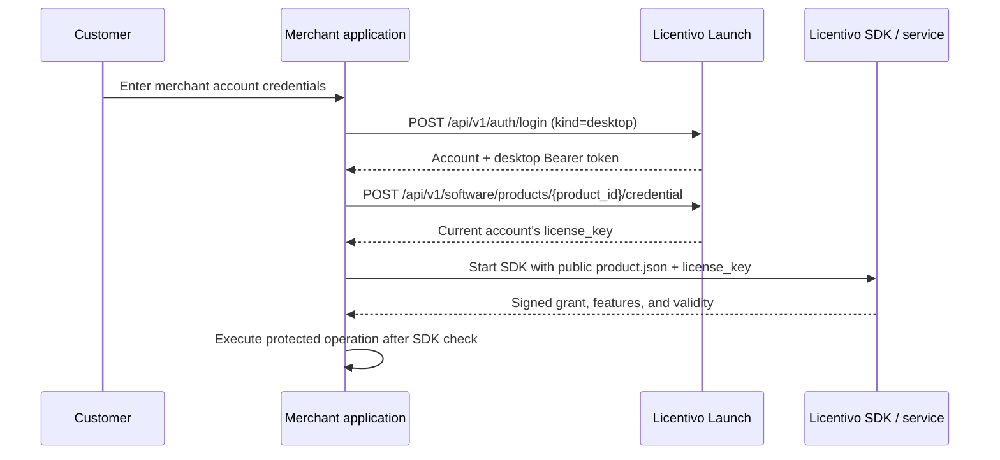

# Application integration with Launch and the Licentivo SDK

This guide is for developers integrating merchant-account purchasing and licensing into C, C++, C#/.NET, Go, Python, or a trusted Web backend. **Launch** is the merchant's self-hosted account/storefront service. **SDK** is the official Licentivo runtime client.

## Two complementary components

1. The **Launch account adapter** signs in to the merchant's service, verifies that the account owns the requested product, and retrieves that account's license credential.
2. The **official Licentivo SDK** handles device identity, activation, signature verification, heartbeats, offline cache, feature permissions, metering, and device deactivation.

Launch does not replace runtime license validation. Checking an order page or hiding a button is insufficient; protected operations must pass the SDK or trusted server-side entitlement check.



Using only the SDK with manual license entry is possible, but it does not provide Launch's merchant-account login, automatic post-purchase retrieval, product isolation, or refund/suspension synchronization.

## Languages without a native SDK

Launch uses ordinary HTTPS APIs, so any language with an HTTP client can authenticate and request its own credential. Runtime licensing also requires signatures, machine identity, heartbeats, offline state, clock-rollback handling, and metering.

Prefer an existing official SDK. Other native languages can bridge to the C SDK through an FFI, DLL/shared library, or a narrow in-process wrapper exposing start, feature check/run, deactivate, and close. Web applications should place SDK checks in a trusted backend. Browser JavaScript must not hold license keys or device private keys. Implement a new runtime client only against an explicitly supported upstream protocol and its compatibility test vectors.

Only public product configuration belongs in an installer. Management API keys stay on the Launch server.

## Public application configuration

| Setting | Source | Safe to distribute |
| --- | --- | --- |
| `MERCHANT_ORIGIN` | Merchant's Launch origin, e.g. `https://shop.example.com` | Yes |
| `LAUNCH_PRODUCT_ID` | The product ID in Launch administration | Yes |
| `product.json` | Public SDK configuration exported for the Licentivo product | Yes |

The public JSON includes the Licentivo origin, product ID, and signature-verification public keys. It must not contain merchant management keys, payment secrets, or customer licenses.

The Launch product ID selects the Launch credential endpoint. The product ID inside `product.json` selects the Licentivo product for SDK verification. They are distinct identifiers. Administrators map them; customers must not choose arbitrary replacements.

## Prepare the merchant backend

1. Create separate Launch products with stable IDs.
2. Create corresponding Licentivo products/policies and export each public `product.json`.
3. Configure one read/write management key in Launch, then select policies by name for sales plans. Launch discovers the remote product and policy version.
4. Publish plans to Launch's `sandbox` payment environment.
5. Configure Stripe or PayPal sandbox credentials and webhooks; verify payment and license synchronization.
6. Verify that the customer's email is confirmed, payment succeeded, entitlement is `active`, and the licensing job synchronized.

`sandbox/live` separates Launch payment records. It does not imply two Licentivo environments. Before these conditions hold, login can succeed while credential retrieval returns `ENTITLEMENT_UNAVAILABLE` or no matching entitlement.

## Desktop integration

### 1. Sign in

```http
POST /api/v1/auth/login
Content-Type: application/json

{
  "email": "customer@example.com",
  "password": "CUSTOMER_ACCOUNT_PASSWORD",
  "kind": "desktop"
}
```

Example response shape:

```json
{
  "data": {
    "user": {
      "id": "ACCOUNT_ID",
      "email": "customer@example.com",
      "verified": true,
      "role": "customer"
    },
    "access_token": "DESKTOP_BEARER_TOKEN",
    "kind": "desktop",
    "expires_at": "EXPIRATION_TIMESTAMP"
  }
}
```

Desktop login omits the browser `Origin` header. Send the returned token through `Authorization: Bearer ...`, never as a URL parameter.

### 2. Retrieve the current account's credential

```http
POST /api/v1/software/products/{LAUNCH_PRODUCT_ID}/credential
Authorization: Bearer {access_token}
Content-Type: application/json

{
  "environment": "sandbox"
}
```

```json
{
  "data": {
    "product_id": "REQUESTED_LAUNCH_PRODUCT_ID",
    "license_key": "CREDENTIAL_FOR_THE_SDK_ONLY",
    "valid_until": "CONTRACT_DEADLINE_OR_NULL",
    "version": 1
  }
}
```

`valid_until` is a timestamp or JSON `null`; the placeholder above illustrates the field. Check that `product_id` matches the request. The endpoint requires a desktop Bearer token, reads the authenticated account, and does not accept a client-selected `user_id`.

All conditions must hold: account enabled and email verified; entitlement for this product/environment; active/unexpired/unsuspended coverage; desired local version synchronized to Licentivo; and a valid current license binding.

### 3. Start the SDK and guard business operations

```text
config = read_public_product_json()
config.license_key = Launch.credential(product_id, environment).license_key
config.cache_path = cache_path_for(account_id, product_id, environment)
sdk = LicentivoSDK(config)
sdk.start()
sdk.run_feature("export", protected_business_action)
```

Grant access only after activation or restoration of a valid signed grant. Check each protected feature immediately before its business action, using the official feature/metering API. Do not parse a license string yourself to grant access. Do not log keys or include them in analytics/error reports.

### 4. Isolate cache state

Scope caches by:

```text
Launch origin + Launch account ID + Launch product ID + Launch payment environment
```

The examples hash these four values with SHA-256 for the cache directory. Account, product, and payment-environment changes must not reuse another identity's device credentials.

### 5. Distinguish close, logout, and device release

| Action | Behavior |
| --- | --- |
| Close application | Close the SDK normally and end the process |
| Log out/switch account | Call `/auth/logout`, clear the Bearer token, close the SDK, and remove the current account/product/environment cache |
| Release this device | Explicitly call SDK deactivation, then log out if appropriate |

Do not deactivate on every ordinary close. Node-locked registrations should not churn; floating seats use the SDK's normal close/release behavior.

## Multiple products

Give each application a fixed Launch product ID, Licentivo mapping, public product configuration, cache namespace, and allowed feature set. Application A must not request product B's credential and reuse A's SDK configuration. Launch verifies account/product ownership, and the SDK separately verifies the remote product and signature context.

## Reference examples

| Language | Account adapter | SDK integration |
| --- | --- | --- |
| C | `examples/native/account.c` | `examples/c/main.c` |
| C++ | `examples/native/account.c` | `examples/cpp/main.cpp` |
| C#/.NET 8+ | `examples/csharp/Program.cs` | `LicentivoClient` in the same file |
| Go | `pkg/launchclient` | `examples/go/main.go` |
| Python | `examples/python/main.py` | Official `Client` in the same file |
| Web backend | `pkg/launchclient` | `examples/web-backend/main.go` |

The upstream SDK is intentionally not committed under `examples/vendor`. Obtain a compatible SDK source directory from [Licentivo](https://www.licentivo.com/) or the [SDK repository](https://github.com/spf86/licentivo-sdk), then prepare the directory containing `c/licentivo.h` and `go/go.mod.template`:

```powershell
./scripts/prepare-examples.ps1 -Source 'C:\path\to\licentivo-sdk\sdk'
```

The helper copies reviewed components to `examples/vendor/sdk` and prepares its Go module. Check `examples/vendor/sdk/VERSION`. The helper refuses to replace an existing directory. Release applications should use the official package or a reviewed pinned SDK version rather than temporary development outputs.

### C / C++

```powershell
cmake -S examples/native -B .cache/examples-native
cmake --build .cache/examples-native --config Release
```

```text
launch_c.exe MERCHANT_ORIGIN LAUNCH_PRODUCT_ID PRODUCT_JSON sandbox
launch_cpp.exe MERCHANT_ORIGIN LAUNCH_PRODUCT_ID PRODUCT_JSON sandbox
```

### C# / .NET 8+

```powershell
dotnet run --project examples/csharp -- MERCHANT_ORIGIN LAUNCH_PRODUCT_ID PRODUCT_JSON sandbox
```

The example targets .NET 8. C# is the language and .NET is the runtime; legacy .NET Framework compatibility requires a separate upstream compatibility check.

### Go

The example has its own Go module. Run it from that directory:

```powershell
Push-Location examples/go
try { go run . MERCHANT_ORIGIN LAUNCH_PRODUCT_ID PRODUCT_JSON sandbox }
finally { Pop-Location }
```

On a POSIX shell, use `(cd examples/go && go run . MERCHANT_ORIGIN LAUNCH_PRODUCT_ID PRODUCT_JSON sandbox)`. The example uses `pkg/launchclient` for accounts and the official Go SDK for licensing.

### Python

```powershell
python examples/python/main.py MERCHANT_ORIGIN LAUNCH_PRODUCT_ID PRODUCT_JSON --environment sandbox
```

The examples read passwords without echo, reject non-loopback plaintext HTTP, limit response size, and isolate account caches.

### Trusted Web backend

Set `MERCHANT_ORIGIN`, `LAUNCH_PRODUCT_ID`, `PRODUCT_CONFIG`, and `LAUNCH_EXAMPLE_ENV` (`sandbox` for local testing), then run the module in `examples/web-backend`. Inspect its sample `/export` endpoint before adapting it. It authenticates the caller and wraps protected work with SDK checks; it is reference code, not a complete Web application.

## Error handling

| Status/code | Application behavior |
| --- | --- |
| `401 LOGIN_FAILED` | Show a generic account/password/status error without confirming account existence |
| `401 UNAUTHORIZED` | Clear the expired/revoked desktop session and return to login |
| `403 EMAIL_VERIFICATION_REQUIRED` | Direct the customer to merchant-site verification |
| `403 ENTITLEMENT_UNAVAILABLE` | Explain that access is pending, expired, or synchronizing; provide an account/status link |
| `404 NOT_FOUND` | Check product configuration or lack of account entitlement |
| `429 RATE_LIMITED` | Respect `Retry-After`; avoid a tight retry loop |
| `503 SERVICE_UNAVAILABLE` | Preserve only SDK-authorized offline behavior and report temporary unavailability |

Display stable business errors, not raw responses, keys, database errors, or upstream credentials.

## Security rules

- Use HTTPS outside loopback sandbox development.
- Do not automatically follow redirects with credentials or request bodies.
- Bound connection time, response sizes, and retries. Do not blindly replay non-idempotent actions.
- Release or overwrite mutable password buffers promptly; do not persist passwords.
- Treat desktop tokens, license keys, device private keys, and SDK cache files as sensitive.
- Ship only public product configuration, never management/payment/master keys.
- Close the current SDK before clearing its scoped cache and switching accounts.

## Release acceptance

For every released language/OS combination, verify registration and email confirmation, no-purchase denial, first activation after payment, restart recovery, offline/heartbeat/clock rules, feature/metering checks, renewal/upgrade/suspension/refund/expiry, full devices and release, logout/account switching, and isolation between products and payment environments.

The repository provides account APIs, the Go account client, and reference source. Complete real payment-to-application activation is still pending merchant service configuration. Real catalog reads and plan mappings do not replace first issuance with a read/write key. See [licentivo-contract.md](licentivo-contract.md) and [progress.md](progress.md).
