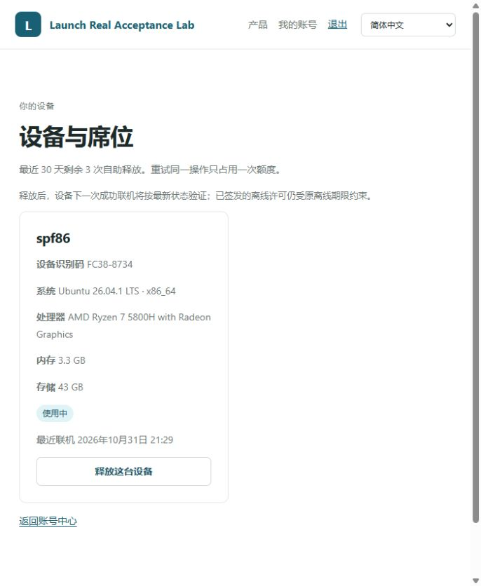
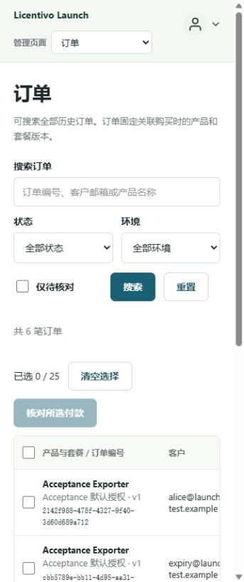
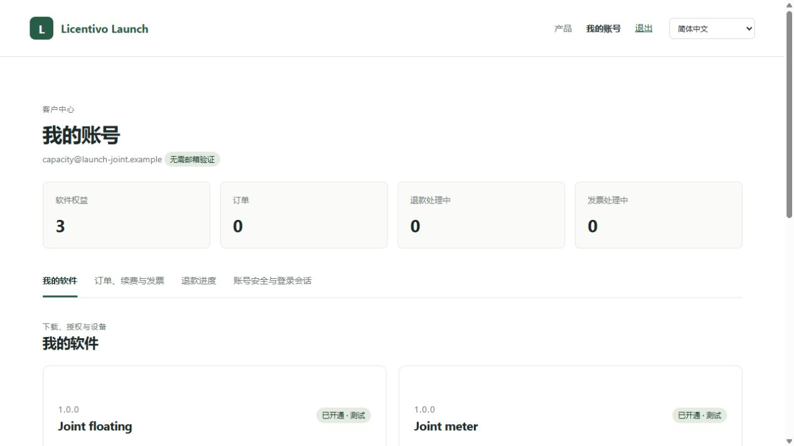
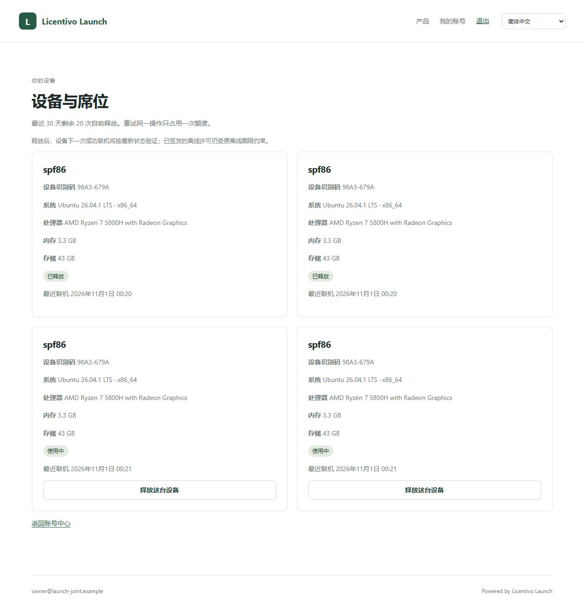
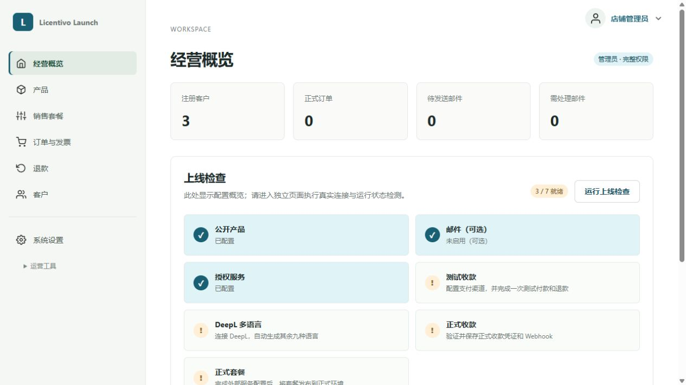
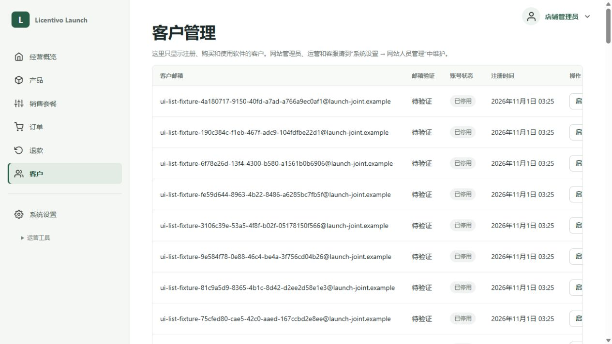

# Launch 与 Licentivo 隔离联测报告

本轮已完成原有 Launch 和 Launch SDK 修复，并在 `192.168.2.177` 新装独立 Licentivo，与独立 Launch 实例进行真实账号、授权、设备及计量测试。**4 小时主循环及追加的 15 分钟长耗时边界测试均已完成。** 新发现的问题保留证据，按用户要求等待决定后再修复；本报告不表示所有功能已通过或所有缺陷已修复。

原始测试及 F01–F04 的发现过程见[首次远端报告](test-report-remote-2026-10-31.md)。本轮不执行需要外部密钥的真实购买、续费、升级、退款、邮件送达或 DeepL 翻译。

授权策略与许可证的逐项状态见[功能覆盖清单](policy-license-coverage-2026-11-01.md)。自动回归、持续循环、真实端到端实测及环境限制分别列出。

## 部署和构建范围

| 项目 | 实际状态 |
| --- | --- |
| 原站 | [18080](http://192.168.2.177:18080/#/admin)，已部署 Launch 修复；保留原数据库与配置，仍连接原 Licentivo 服务 |
| 隔离 Launch | [18092](http://192.168.2.177:18092/#/home)，独立数据库 `launch_joint_20261031` |
| 新装 Licentivo | 服务器本机 `127.0.0.1:18091`，独立数据库 `licentivo_joint_20261031`；不向局域网开放此管理端口 |
| 数据库 | 复用既有 MySQL 8.4.11；新增专用用户及隔离数据库，不替换既有数据 |
| 初始授权 | 仅在隔离库建立明确的测试权益，由 Launch 正常持久任务队列向 Licentivo 同步；本轮隔离库订单、支付均为 0 |
| SDK | Launch SDK 0.1.7 与内嵌官方 SDK 0.11.7 的工作区源码构建，包含另一个 AI 完成的 F03 和浮动账号修复；未发布至公共包仓库 |
| 实际系统 | Linux amd64 服务端和客户端；实际 Windows 客户端使用硬件信息与当前用户 DPAPI。未伪造设备指纹 |
| 外部服务 | 不使用真实支付渠道、SMTP/Resend 或 DeepL 密钥 |

原站 Launch 二进制 SHA-256：`941c5c8cae9e5565a1791f82e80a13ab17119e70e3e0ef8bf82fd714919d6da7`。

隔离 Launch 二进制 SHA-256：`b5fb4d0d2696a488bb330b2bf150e6161fbe9362c1179456fdeb97d764e5be7d`。它使用仅供联测的构建覆盖，将原本固定的官方服务地址改为本机 Licentivo，并启用本机测试传输；没有改动业务算法。生产源码没有新增这项地址覆盖设置。[准确构建差异](joint-acceptance-20261031/routing-differences.json)。

新装 Licentivo 二进制 SHA-256：`80b724b1009e4567b08bf7385ce297e310386700b080659d738c202f254c0945`。实际 Python wheel SHA-256：`878e9dc5f6fbd4405a57aa182625acec25f9f75b30993e063ebca486a8d13fd4`。版本号没有改变，不能据此认为当前公共发布包已经包含修复。

## 已授权修复的复测

| 原问题 | 修复与实际复测 |
| --- | --- |
| F01 HTTP 页面调用 UUID 失败 | 使用安全随机字节生成 UUID，兼容远端 HTTP 缺少 `crypto.randomUUID` 的浏览器；18080 实际设备页及续费确认页通过 |
| F02 权益已同步但状态错误 | 移除对旧 `license_bindings` 记录的依赖，按当前购买引用及同步版本判断；真实桌面状态返回 `ENTITLEMENT_READY` |
| 浮动策略错误被误写为版本变化 | Launch 保留经过清理的真实远端错误码及请求编号；只有真实策略版本冲突映射为 `LICENSE_POLICY_CHANGED` |
| F04 启动失败被清理异常覆盖 | Python、JavaScript、Java、C#、Ruby 保留原授权错误；未购买账号的真实结果为 `LAUNCH_ENTITLEMENT_REQUIRED`，不执行业务 |
| F03 跨进程计量恢复 | 使用另一个 AI 完成的官方 SDK 和后端修复；真实固定、浮动客户端换进程及换身份后恢复同一任务，不重复执行业务；另见本轮发现的并发边界 N04 |
| Launch 浮动账号接入 | 新装修复后端支持映射、账号兑换、设备凭据、席位及退出；9 种语言各完成固定和浮动流程，共 18 组通过 |

## 实际主业务测试

| 场景 | 已完成结果 |
| --- | --- |
| 9 种语言真实账号流程 | Python、Go、JavaScript、Java、Ruby、C、C++、C#、Rust 均在 Linux 实际运行；各执行固定/浮动，共 18 组；真实登录、业务文件写入、未授权功能拒绝、关闭后恢复、退出及未购买账号原错误全部通过。[结果](joint-acceptance-20261031/language-final.json) |
| 实际 CSV 小程序 | 可交付的 [main.py](../examples/acceptance-exporter/main.py) 在固定、浮动账号下真实写出 CSV；换进程重复原计量编号，文件内容及修改时间不变；退出后不能恢复 |
| 提交与取消故障 | 固定/浮动分别测试确认前断网、服务器处理后丢响应、取消前断网、取消后丢响应、业务写盘后进程强退；10 个故障场景的首次状态与恢复检查通过。业务成功的只执行 1 次，取消的不执行 |
| 结果未知的任务 | 实际 `os._exit(77)` 终止在业务已写盘但尚未提交的时点；恢复时拒绝盲目重复，核实结果并 resolve 后可以完成原任务 |
| 常规双进程同任务 | 独立恢复 Launch 登录的两个进程同时执行同一任务，3 轮均只有 1 次业务，另一进程收到幂等冲突；预先初始化 SDK 再 fork 的条件例外见 N04 |
| 低额度边界 | 新建真实 2 次额度；前两次计量导出成功，第 3 次 `FEATURE_QUOTA_EXCEEDED`，业务不执行；用尽额度后重放已提交任务不重复扣量或执行 |
| 策略变更和历史用量 | 将专用额度从 2 提到 3，既有授权只多允许 1 次，没有清空历史用量；旧版本编辑返回 `409 POLICY_CHANGED`。测试后恢复额度 2，并将专用预览套餐重新映射到当前策略版本 |
| 应用版本限制 | 通过真实策略设置允许 `2.0.0`–`3.0.0`；缺失或格式错误版本返回 `APP_VERSION_REQUIRED`，范围外返回 `VERSION_NOT_ENTITLED`，业务不执行；两个边界版本均成功执行实际业务；测试后还原版本约束和套餐映射 |
| 参数边界 | 0、负数、小数、布尔、字符串、空数量、超出整数范围，以及空/超长/含空白操作编号均拒绝；改动原任务数量拒绝 |
| 任务文件损坏 | 截断 JSON、超大文件、错任务号、缺失预留编号、未知状态均拒绝重复业务；恢复有效文件后原任务安全重放 |
| 真实文件权限故障 | SDK 任务目录设为当前用户不可写；预留后持久记录失败，业务不执行，预留被取消；恢复权限后新任务成功 |
| Launch 停服退出 | 固定/浮动退出后立即停止本地业务，账户退出任务持久保存；新进程不得恢复权限；服务恢复后完成退出，旧桌面会话 401，新登录可执行业务 |
| Licentivo 停服退出 | 固定/浮动立即停止本地业务；Launch 本地账号退出完成，SDK 保留授权侧撤销状态；服务恢复后可以新登录，旧账号会话不能恢复 |
| 管理密钥轮换 | 仅轮换新装实例测试密钥；Launch 仍用旧密钥时本地退出成功，远端撤销持久等待；更新密钥后自动投递，已运行的旧客户端被拒绝，新登录成功 |
| 独立账号会话 | 固定/浮动分别建立两个真实会话，明确退出其中一个；旧会话 401，另一个会话仍可刷新、执行实际业务并换进程上下文恢复 |
| 密码变更撤销 | 通过正常 API 修改专用 capacity 账号密码；真实安全通知投递后，固定/浮动旧桌面会话均 401，已运行 SDK 得到 `DEVICE_CREDENTIAL_REVOKED`，不执行业务；新密码可登录使用；最后已还原测试密码 |
| 暂停授权的负向对照 | 真实暂停隔离 Alice 的固定/浮动许可证；9 种语言共 18 组均拒绝业务，原业务文件未改写；恢复许可证后重新登录、执行真实业务成功。小程序部分兜底只打印异常类型，不能据此把它当作 SDK 改写了错误码 |
| 实际席位限制 | 同一 Linux 设备两个浮动实例占一个设备名额；Windows 客户端被拒绝。关闭一个 Linux 实例后 Windows 仍被拒绝；全部关闭后 Windows 成功导出并退出，Linux 随后可登录 |
| 释放次数与幂等 | 重复同一释放返回同一操作，额度只减 1 次；释放一条浮动实例记录后同机器另一实例继续可用。错误状态映射见 N05，界面概念问题见 N01 |
| 身份签名与隔离 | 实际校验 Ed25519 签名、产品/环境/来源、120 秒寿命及每次不同的 jti；网页会话不能申请桌面身份，带浏览器 Origin 的桌面登录被拒绝 |
| 身份自然到期 | 实际等待约 123 秒，固定/浮动旧断言均被 `LAUNCH_IDENTITY_INVALID` 拒绝；申请新断言后真实业务成功，未修改时钟 |
| 固定许可自然离线到期 | 单独隔离该 SDK 网络，真实签名有限许可在到期前允许；等待 30 分钟后阻止业务。此时账号授权会话也到期，按 `LAUNCH_LOGIN_REQUIRED` 重新登录后恢复成功 |
| 浮动客户端断网恢复 | 新客户端不能依靠缓存离线启动；已运行客户端断网后拒绝受保护操作，等待实际约 690 秒心跳许可截止后仍拒绝；恢复网络获得新签名许可并成功执行实际业务 |

计量接口和普通功能门禁是不同 API：`run_feature` 不扣计量次数；需要计量的业务必须使用 `run_metered_feature`。本轮额度检查使用后者。Launch 各语言外层没有统一暴露同等高级计量接口，不能把普通门禁示例的成功视为各语言高级计量 API 验收。

本轮计量故障恢复、文件故障及并发实验使用 Python 真实客户端；9 种语言主流程矩阵验证的是账号与普通功能门禁。持续测试还以 MySQL 只读一致性快照核对业务记录、每个计量任务的已提交预留和累计用量，[账本核对结果](joint-acceptance-20261031/soak-ledger-check.json)已经在结束后完成终检。额外的单次重新登录探针不混入循环任务数量。

新装实例实际生成的 [固定授权 CSV](joint-acceptance-20261031/actual-fixed-report.csv) 和 [浮动授权 CSV](joint-acceptance-20261031/actual-floating-report.csv) 均已保留，SHA-256 为 `3731f0fd17a8490b28341b00cc3fce455fb33be51020a11c51626b87a981d17d`。

## 后续授权策略与许可证实测

高级链路使用新建的独立授权产品和许可证，Python 实际 SDK 执行业务；Windows 另做真实硬件及换机验证。[完整观测](joint-acceptance-20261031/advanced-policy-evidence.json)、[Windows 观测](joint-acceptance-20261031/windows-advanced-evidence.json)。

- 永久、定期、试用发证及首次激活通过；定期/试用管理续期保留初始激活锚点。实际暂停后拒绝业务，恢复后新实例可用；终止吊销不能恢复或续期，删除后管理查询及在线客户端拒绝。
- 离线申请、批准、导入、业务和注销完整链路通过；批准签名篡改、旧批准恢复权限均被拒绝。另用三个独立进程实际写出申请文件、写出批准文件、断网导入并写业务文件。有效离线许可下尝试计量，未取得服务器预留时不执行业务；联机换进程后原任务成功且仅计 1 次。
- 基础额度 2 加最大超额 1，前三次成功、第四次拒绝。固定、浮动分别用 10 个真实 SDK 实例并发争用 5 单位额度，均恰好成功 5 次、拒绝 5 次，账本 5 个已提交、0 个遗留预留。换实例重放完成任务无新增业务。
- 日、月周期使用明确的历史用量夹具，本周期额度独立；维护期使用历史截止时间夹具，旧版本允许、新版本拒绝，管理续维护后恢复。定期/试用的独立测试许可证显式缩短至 45 秒后，按真实时钟等待截止，缓存和在线验证均拒绝；正常管理续期后原密钥恢复。这些不等于等待原始一天或自然跨月。
- Linux 实际报告 VM=true、无硬件标识，禁止 VM 和强制硬件策略正确拒绝。Windows 实际报告 VM=false、有硬件标识，对应策略执行业务通过；没有伪造设备信息。复制 Linux 签名缓存不能在 Windows 离线授权；Linux 占满设备数时 Windows 在线被拒绝，释放后 Windows 接替成功。
- 实际单张及批量发证、策略预览、旧预览拒绝、无效第二项整批回滚、幂等重试通过；策略替换保持原密钥、购买期限和用量。管理员明确查看密钥成功，普通读取不返回完整密钥，API key 请求查看密钥被拒绝；真实 CSV 导出处理表格公式前缀。
- 客户门户在显式邮件令牌夹具后，通过正常验证、设备改名、释放和重复释放；同次释放不多扣额度。Linux 释放后 Windows 仅凭临时码激活，凭设备凭据恢复，Linux 重用临时码被拒绝；本月额度耗尽、旧设备代数和旧别名均正确拒绝。门户退出后不能再读取许可证。未验证真实邮件送达。
- Launch 账号将永久离线、零心跳源策略收紧为 600 秒心跳、1800 秒有限账号许可。固定↔浮动切换在存在活动绑定时返回冲突，释放后正常切换；原许可证编号、历史计量用量保持不变。

补充的真实管理权限测试通过：只读 API key 可读取其租户许可证，发证、编辑、撤销、删除、完整密钥查看及 API key 管理均被拒绝，原数据及数量不变。未启用 HTTP 站点的写 key 注册 HTTP Launch 信任返回明确错误，原连接没有被替换；两个专用测试 key 已撤销，旧值读取均为 401。

Launch 另补 [66 项真实员工权限与会话安全检查](joint-acceptance-20261031/staff-security-evidence.json)，全部通过。正常创建运营和客服账号验证权限边界；降权及升权使旧网页/桌面会话失效，停用拒绝登录，重新启用不复活旧会话，最后一名管理员不能停用或降权；CSRF 缺失/错误及跨站请求被拒绝，不能凭另一用户的会话 UUID 撤销其登录。专用测试员工已停用，原管理员不变。

后续安全及轮换实测也已完成，[原始观测](joint-acceptance-20261031/security-followup-evidence.json)：

- 停用专用客户后，实际持久通知投递成功；固定/浮动旧网页及桌面会话被拒绝，在线 SDK 返回 `DEVICE_CREDENTIAL_REVOKED`，业务回调为 0。重新启用后旧会话仍失效，重新登录恢复实际业务；已还原 active 状态。
- 新增第二租户，在两个租户之间双向测试真实资源 UUID 的读取、编辑、吊销、删除、按外部产品过滤、混合租户批量预览和伪造租户请求头，均未越权，两张许可证内容不变。第二租户的预验证账号是明确的数据库夹具，不代表注册、法律同意或邮件送达通过；其正常 API 创建的测试 key 已撤销，用户已停用、租户已暂停。
- 固定/浮动各 8 种身份令牌篡改被实际服务器拒绝。合法身份未被错误请求消耗；原兑换的相同请求和编号可安全重试，换编号或改正文返回 409，退出后不能用原请求复活授权。此处篡改后没有重签名，不能把签名校验通过归为有效签名下每个声明边界都单独验收。
- 独立产品通过正常 API 轮换签名 key，旧公钥保留用于验证已有签名，新签名只使用一个新活动 key。只有旧 pins 的客户端拒绝新签名；发布含新旧公钥的 pins 后，原许可证、激活及设备凭据不变，计量任务重放没有重复业务，换实例只对新业务计量。旧离线许可仍受原期限约束；没有自动信任未知公钥。

## 本轮已授权的订单界面调整

后台名称改为「订单」，移除客户手工申请和后台处理发票表单；写入接口返回 `410 INVOICE_REQUESTS_DISABLED`，历史数据及只读接口保留。「主动核对付款」保留，改为服务端完整历史搜索、状态/环境/待核对筛选、分页、行内操作及最多 25 笔的跨页选择，每 5 笔一批显示结果。提交前展示具体订单、客户与金额；请求结果不明确时不自动重试后续批次。

状态同时显示文字和颜色：付款绿色、等待及退款中橙色、退款蓝色、撤款红色、关闭灰色。

已通过独立 MySQL HTTP 回归的 10 个顶层测试、前端 63 项及 Go vet。浏览器实际验证 120 笔合成订单的 5 页、旧订单精确搜索、组合筛选、跨页预览、25 笔选择限制及缺少支付记录时逐笔失败；原站两笔既有测试订单的内部核对完成。没有通过真实支付渠道验收。120 笔 UI 夹具已全部清理，隔离库恢复为订单 0、支付 0；客户历史上限问题另记为 N07。

[订单管理说明](order-management.md)、[浏览器证据](joint-acceptance-20261031/order-ui-browser-evidence.json)、[实际 HTTP 回归](joint-acceptance-20261031/order-http-regression.json)、[部署及暂停记录](joint-acceptance-20261031/order-deployment-history.json)。最后部署保留原 soak PID 55544，暂停不计入有效运行时间。

## 新发现且尚未修复的问题

当前共 **8 项确认缺陷和 1 项 SDK 能力缺口**。N01–N05、N07–N09 为缺陷，N06 为能力缺口；均保留复现结果，等待用户决定修复范围。

### N04 Python 官方 SDK 在 fork 工作进程中可重复执行同一计量任务

优先级 P1，主要归属 **Licentivo 官方 Python SDK**；Launch 内嵌该实现，上游修复后需要同步内嵌源码。本轮不修改官方 SDK。

条件：Linux 上正常取得授权后，在没有后台线程的 SDK 构造阶段初始化客户端，再 fork 两个工作进程；两个进程共享原缓存和同一业务操作编号。测试只同步真实 reserve 响应的返回时点，没有改动请求编号、设备指纹、服务端响应或业务结果。

两次独立操作均出现：两个进程都成功，业务 CSV 各写入 **2 次**，服务器对应操作各只有 **1 条 quantity=1、status=committed 的预留**，本地最终任务记录也为 committed。单进程顺序重试的通过结果不能覆盖此并发条件。[业务计数、服务器预留与任务记录](joint-acceptance-20261031/concurrent-fork-duplicate.json)。

原因：Python 的 `threading.Lock` 只协调本进程；fork 后各进程分别持锁，均可读到未开始的任务并获得相同 pending 预留，然后各自执行回调。需要明确跨进程执行所有权或拒绝这种共享方式；不能仅靠重复 HTTP 请求的扣量幂等防止业务重复。

复现程序保留在服务器 `joint-acceptance-20261031/fork_concurrent_meter.py`；以现有虚拟环境运行。已确认 Python/Linux 条件，不推断其他语言或所有并发部署均有相同缺陷。

### N09 计量业务超过默认 15 分钟后，SDK 一直待确认且无法结算

优先级 P2，主要归属 **Licentivo 官方 Python SDK 的计量任务封装和错误状态处理**。Launch 内嵌同一实现，需随上游修复同步；本轮该长耗时复现使用直接许可证模式，没有逐语言重复 15 分钟场景。

使用真实服务器默认预留 900 秒，没有修改预留参数、响应或系统时钟。实际回调从 19:37:05 UTC 运行至 19:52:07 UTC，每秒写入模拟慢任务数据，共生成 900 行带校验值的 CSV，然后完成受保护业务。提交返回 `RESERVATION_EXPIRED`，业务回调为 1 次，服务器累计用量为 0。换新 SDK 进程重试原任务，以及 `resolve_metered_feature(operation, True)`，都继续收到相同过期错误，日志保持 `commit_pending`；没有重复执行原业务。

截止前另一个新任务被 `FEATURE_QUOTA_EXCEEDED` 拒绝，回调为 0；截止后原预留已不再占额度，新短任务可正常完成。最终两次不同的实际业务对应累计用量 1。服务器拒绝过期预留属于既定合同；此问题是高层 SDK 将不可继续提交的确定性失败仍包装为待确认，缺少长任务续预留、终态及已完成业务的结算恢复机制。

`licentivo_tasks._finish` 将所有提交异常都包装为 confirmation pending，未区分临时响应未知与明确的预留过期。需由产品确定长任务支持范围和恢复方案；不能只要求用户无限重试，也不能自动重做已经完成的业务。

[完整实测结果](joint-acceptance-20261031/long-meter-evidence.json)、[实际预留、CSV 校验与进程终态](joint-acceptance-20261031/long-meter-final-audit.json)、[900 行模拟业务 CSV](joint-acceptance-20261031/long-meter-business.csv)。原工作进程已结束，系统日志确认正常结束，测试激活已退出；已过期的原预留及待确认日志保留作为证据。此项尚未修复。

### N01 浮动实例被显示为设备和席位

优先级 P2，主要归属 **Launch 前端及设备接口展示契约**。一个物理设备的两条浮动实例共占一个真实设备名额，但账号页显示“2 台/席位”，设备页出现相同硬件码的两张使用中卡片。点击“释放这台设备”只释放对应实例，另一个实例仍可执行功能。

需要明确区分物理设备、运行实例和席位，并显示实际释放范围。不能仅用截短的硬件显示码做安全去重。后端真实容量限制有效，未发现多占用绕过。

### N03 在后台入口的登录表单提交后页面不刷新

优先级 P2，归属 **Launch 前端**。未登录时直接访问 `#/admin`，页面原地显示登录表单；管理员提交成功后仍停在表单，刷新浏览器才出现后台及左侧栏。

登录处理仅把 hash 设为 `#/admin`；当前 hash 已经相同，未触发 `hashchange`，因此没有重新渲染。实际 18080 后台根路由已复现。隔离新站客户 `#/account` 根路由也已复现：提交后保持登录表单、按钮恢复可用且无错误提示，刷新后同一会话显示 5 项软件权益。需要在登录完成后显式渲染或处理同路由导航。[客户根路由证据](joint-acceptance-20261031/customer-root-login.json)。

### N05 设备释放的确定性冲突被改写为服务不可用

优先级 P2，归属 **Launch 服务端**。对两个真实浮动实例使用同一释放操作编号，第二个请求内容改变时：Licentivo 明确返回 `409 IDEMPOTENCY_CONFLICT`，Launch 返回 `503 LICENTIVO_BRIDGE_UNAVAILABLE`。

对应 Launch 请求编号 `14e9821a2e503e25766dd85576388965`，直接对照 Licentivo 请求编号 `ff1bf1d8-0791-401e-8d88-ca8be2578d2c`。`internal/app/devices.go` 将释放调用的全部远端错误统一处理为临时不可用，容易让调用方不断重试错误请求。正常原请求重试只扣一次额度，此项没有发现重复扣次。

### N07 客户订单历史只返回最近 100 笔且总数显示不完整

优先级 P2，归属 **Launch 服务端及客户中心前端**。临时建立 120 笔合成订单后，后台完整历史为 120；客户接口只返回 100 条，账号页把数组长度显示为「订单 100」，没有分页，早期 20 笔不能从订单列表进入。

`internal/app/management.go` 的 `Orders` 固定 `Limit(100)`，`account()` 以 `orders.length` 作为计数。需要分页/独立总数，或明确最近记录的展示范围。证据在 [浏览器结果](joint-acceptance-20261031/order-ui-browser-evidence.json)；测试夹具已清理，不影响既有订单。此项尚未修复。

### N08 后台客户超过 100 人后，早期客户无法从页面找到

优先级 P2，归属 **Launch 前端及客户管理列表接口**。在新装隔离库临时添加 120 个停用且不能登录的客户夹具，数据库及经营概览均为 126 人，真实浏览器客户页只有 100 行，没有搜索字段、总数或上一页/下一页。原有 Alice 不在页面中，管理员因此不能从页面对其执行账号操作。

`Users` 固定 `Limit(100)`；后端虽然支持 `q` 邮箱前缀查询，但页面没有发送或提供此入口。直接查询 `q=alice@launch-joint.example` 仍返回原客户，确认是列表可访问性问题，数据未丢失。需要完整历史的搜索、分页和总数。

[接口与清理结果](joint-acceptance-20261031/customer-list-limit.json)、[浏览器行数及缺少入口的证据](joint-acceptance-20261031/customer-list-browser.json)。120 个夹具已经全部删除，恢复原 6 个客户；没有为夹具创建登录会话、订单或授权。此项尚未修复。

### N06 多语言高层计量接入能力不一致

优先级 P2，归属 **Launch SDK 和接入代码生成**，作为待用户决定的能力缺口列出。Python 的公开运行实例可调用计量任务；其余八种语言的标准 Application 入口只有普通功能门禁，没有统一的计量/恢复转发接口。内嵌官方 SDK 含相应实现，部分语言支持自定义 RuntimeFactory，应用需要自行写适配器或接入独立官方 SDK。

实际 Go 编译探针确认 `Application.RunMeteredFeature` 不存在。专用授权规则额度 2、已用 3 时，Go 的普通 `RunFeature` 仍完成 2 次业务，用量保持 3；这是该非计量函数的既定合同，不能用作扣量接口。接入代码需要明确区分普通功能和计量功能，计量任务及恢复应委托同一个官方 SDK 运行实例。

[接口检查及真实 Go 探针](joint-acceptance-20261031/sdk-metering-interface.json)。本轮九语言通过的是账号与普通门禁；高级计量及故障恢复主要验证 Python，没有宣称八种语言的标准入口已经支持同等功能。

### N02 未配置翻译服务仍提示正在生成

优先级 P3，归属 **Launch 前端及站点状态表达**。新装实例没有 DeepL 配置，管理接口确认 `configured=false`、完成数 0；英文站点 `translation_ready=false`，前台却固定提示“所选语言的内容正在生成”。没有翻译配置时不会运行翻译，应显示原文回退状态，不能宣称任务正在执行。

## 自动回归和测试条件修正

Launch 原修复已通过 Linux 原生 Go 与真实 MySQL 回归、前端 59 项、Python 23 项、JavaScript 22 项，以及 Java、C#、Ruby 对应回归；Go vet 通过。16 个 Go 包均成功，118 个顶层测试、343 个含子测试节点通过。[原修复验证摘要](joint-acceptance-20261031/original-fixes-verification.json)保留原站 F04 首次断言失败及后来重跑通过的状态；详细原始记录保留在本机 `.local/remote-fixes-20261031/`。

新 Licentivo 的完整 HTTP API 测试在独立数据库运行约 699 秒：原始结果 **319 个顶层测试通过、571 个含子测试节点通过、2 个顶层失败、32 项按环境开关跳过**。两个失败分别为：

1. `TestCurrentAuthorizationRuntimePolicy` 假定默认心跳 3600 秒、有限离线 86400 秒；首次测试配置沿用自然到期测试的 600/1800 秒。仅修改专用测试配置后，该项 8 个节点通过，运行服务的有限期限配置没有改变。
2. `TestManagementDocumentationResponses` 使用 `Now().AddDate(0,-1,0)` 选择上个月。UTC 10 月 31 日会将不存在的 9 月 31 日规范化成 10 月 1 日，服务器正确返回 `month_not_closed`。这是 **Licentivo 测试夹具日历缺陷**。只在本机测试构建覆盖为“先取月初再减月”，未改官方源码或运行服务；完整管理响应契约补跑 42 个节点通过。

原始失败不删除、不改写。补跑和构建覆盖均单独留痕；不将环境跳过的 SDK/browser 项写为该原生套件已通过。[原始摘要与运行策略补跑](joint-acceptance-20261031/licentivo-native-summary.json)。

探索性记录保留已纠正的预期或脚本问题：预览套餐就绪条件、桌面登录 Origin、非 sandbox HTTP、并发屏障、永久许可的 9999 年期限表示、暂停后需新实例，以及门户设备字段和临时码错误名称。修正后均已用实际请求补测；它们与 N04 的两个进程都成功并重复写盘不同。[逐条分类](joint-acceptance-20261031/functional-failure-classification.json)。观测记录还包含登录、配置读取等步骤，其条数不等于独立测试用例数。

## 持续测试

真实循环从 **2026-10-31 15:47:42 UTC 运行至 19:48:42 UTC**，即北京时间 10 月 31 日 23:47:42 至 11 月 1 日 03:48:42。累计有效运行 **14400.21 秒、320 轮**；总经过时间 14460.66 秒，受控暂停约 60.45 秒不计入有效时长。原进程 PID 55544 已于 19:48:43 UTC 退出，最终摘要 `done=true`，独立结束核对已完成。

循环使用真实 SDK 运行固定、浮动及计量产品，持久写业务文件；换进程重复相同编号，检查回调不重复；定期退出、拒绝恢复、重新登录，并检查两服务健康。最初只运行固定与计量产品，随后启用浮动及换进程重放；最终记录各产品的首次/末次执行时间，不把整个循环的 4 小时写成每个子场景均连续运行了 4 小时。这是每约 45 秒一轮的持续功能稳定性测试，不是吞吐量或大规模并发基准。

前 30 分钟后，测试配置的 1800 秒账号授权会话自然结束，旧脚本未处理重新登录，记录 **9 次 `LAUNCH_LOGIN_REQUIRED`**。已逐项核对这 9 次业务回调全部为 0。脚本随后仅对专用 soak 账号按 SDK 明确要求重新登录，保留原始失败记录，继续运行；没有扩大服务器授权期限或放宽业务门禁。

最终原始摘要：[soak-summary.json](joint-acceptance-20261031/soak-summary.json)，已经与原进程终态及实际业务账本核对。

最终为 **2636 条检查记录：2627 通过、9 条上述会话到期记录**。原循环因此保留退出码 1，没有把历史失败改成通过；独立结束核对进程正常退出码 0，并确认修正脚本后没有新增失败。

| 产品 | 首次 / 末次实际业务（UTC） | 成功业务 | 换进程重放 |
| --- | --- | --- | --- |
| 固定 | 15:47:44 / 19:47:58 | 320 | 316 |
| 浮动 | 15:50:46 / 19:48:03 | 307 | 307 |
| 计量 | 15:47:45 / 19:48:00 | 320 | 316 |

合计 947 个成功操作各有且仅有 1 次真实 CSV 业务，939 次重放均无新增回调；9 个失败操作回调均为 0。只读一致性快照中，固定/浮动/计量分别为 320/308/320 个已提交预留，累计用量逐项相等、无遗留预留、无异常任务状态。浮动额外 1 条为已明确标记的独立重新登录探针，不混入循环 947 个操作。

最终三项运行服务均 `/readyz=200`；14 条权益同步任务完成，账号安全通知为 168 条已送达、1 条不需送达，没有待处理或人工核对队列。[结束核对](joint-acceptance-20261031/completed-acceptance-audit.json)、[实际进程终态](joint-acceptance-20261031/terminal-process-observation.json)、[业务与账本核对](joint-acceptance-20261031/soak-ledger-check.json)、[各产品起止记录](joint-acceptance-20261031/snapshot.json)。这些结论限定为本次循环及对应队列，不代表报告中的 N01–N09 已经修复。

追加长任务已于 19:52:08 UTC 完成，并核对原进程结束及 CSV、服务器预留、用量与激活退出。该独立许可证不在主循环的 3 组账本内，实际发现 N09；没有将它混入主循环通过结果。原始观察中明确区分真实 SDK/HTTP/磁盘读写与一秒间隔模拟的慢业务，不把它描述成吞吐量测试。

## 界面变化和环境边界

18080 使用原有 ocean 主题及测试品牌，18092 使用新安装的 forest 默认主题和独立测试商品；浏览器当前选择 English。两个站的 `app.js`、`app.css`、`interface.css`、`order-management.js` 哈希完全相同，[对比证据](joint-acceptance-20261031/frontend-comparison.json)。左侧导航属于管理员后台，客户首页和登录表单只有顶部导航，没有删除原后台侧栏。

两个端口使用同一个 IP 和相同 Cookie 名称。浏览器 Cookie 不按端口隔离，在新站登录会替换旧站 Cookie；实际对照为旧站 `/me` 从管理员 200 变为 401，新站客户 200。[独立会话罐复现](joint-acceptance-20261031/same-host-session-collision.json)。后续测试使用独立脚本会话，避免继续覆盖浏览器登录。需要两个站长期同时登录时，应使用不同站点主机名或独立浏览器会话。

仍未覆盖：真实外部支付及回调、邮件送达和翻译质量；公网 HTTPS/正式 live 部署；macOS、ARM64、移动系统；多节点集群、整机断电、系统时钟回拨、磁盘写满和大规模独立设备压测。已完成真实请求/批准文件的跨进程导入及离线业务；客户端断网使用进程专用代理隔离，没有物理拔网或 USB 跨机器交付。9 种语言的客户端实测在 Linux 运行，Windows 额外执行 Python 席位、硬件策略、缓存迁移和门户换机客户端，不能推定 9 种语言在所有平台均已通过。

新装 Licentivo 仅绑定服务器本机，客户端当前使用回环地址测试。需要在本机查看管理界面时，可建立 SSH 转发：`ssh -N -L 18091:127.0.0.1:18091 spf86@192.168.2.177`，再访问 `http://127.0.0.1:18091`。公网客户端接入仍需要正式的 HTTPS 域名与对应配置。

服务、数据库、虚拟环境、9 种语言的小程序及测试记录保留在服务器 `/home/spf86/joint-acceptance-20261031`。凭据、令牌和密钥只在忽略的私有目录保存，不进入报告或公开证据。

最终直接核对三项运行进程的可执行文件 SHA-256 与本报告构建一致，MySQL 版本为 8.4.11，隔离库保留 14 个测试权益、6 个客户，订单和支付均为 0；两名专用员工已停用。[环境终检](joint-acceptance-20261031/environment-final-audit.json)。临时浏览器代理已停止，原有 SSH 管理转发保留供用户查看。

[本轮完成核对](joint-acceptance-20261031/run-completion-audit.json)对应部署、原修复、本轮真实业务、4 小时运行及终止、SDK 正反向验证、订单调整、追加缺陷取证和夹具清理。它验证的是本轮工作完成及证据完整性；待用户决定的缺陷和上述未测条件仍然保留。
