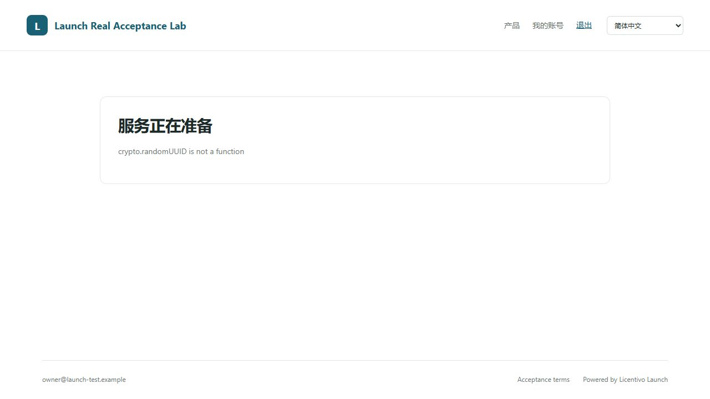

# Launch 远端实际业务测试报告

这是首次测试记录。原有修复状态、新装 Licentivo 的隔离实测和后续新问题见[本轮联测报告](test-report-joint-2026-11-01.md)；其中持续测试尚在运行，完成后再给最终结论。

2026-10-31，北京时间。结论：安装完成，主要业务链路可运行；发现 **4 个需要处理的问题，以及 1 个浮动授权接入限制**。本次不判定为全部功能验收通过。

测试实例：[http://192.168.2.177:18080](http://192.168.2.177:18080)。服务和测试数据已保留。管理员及客户测试密码仅保存在本机忽略目录 `.local/remote-acceptance-20261031/access-private.txt`，不进入本报告。

## 环境与真实性

| 项目 | 实测内容 |
| --- | --- |
| 目标机 | SSH 登录 `spf86@192.168.2.177`；Ubuntu 26.04.1 LTS，Linux amd64 |
| MySQL | 已有 MySQL 8.4.11，复用服务；新增独立数据库和专用用户，未替换已有数据库 |
| Launch | 当前工作区源码交叉构建的 0.3.5-beta，原样部署，未修改产品业务代码 |
| 客户端 | 新增 Python CSV 导出小程序；Launch Python 0.1.7，内嵌官方 SDK 0.11.7；Linux、Windows 两个实际系统均运行 |
| Licentivo | 调用真实 `https://www.licentivo.com`，实际连接注册、策略映射、购买事件、身份兑换、签名许可、设备及计量操作 |
| 支付与退款 | 按用户授权，在独立测试库构造支付事实；测试专用命令只替代支付网关返回值，调用 Launch 原有订单、付款确认、覆盖账本及退款处理代码；后续授权同步和 SDK 全部使用真实服务 |
| 源码基线 | Git HEAD `c04d4ee98e22315087d427d273b8fbd7c9f8a755` 加当前未提交修改；不可仅凭公开版本号推定发布包与此构建相同 |
| 二进制 SHA-256 | `23d0bbb0a4afa48f3f3b121ed1e41a67692dc3ecd2f838fd4cd459013ce83bbf` |

支付渠道的真实交易、邮件送达及 DeepL 调用，按用户后续指示跳过。没有把模拟付款或本地测试替身记为外部支付成功。

## 主业务实际结果

| 场景 | 结果与证据 |
| --- | --- |
| 部署、启动、健康检查 | 通过；systemd 服务启用，MySQL/Launch active，`readyz` 和 `launch check` 成功 |
| 管理员首次登录 | 通过；强制修改初始密码，旧会话立即失效，未改密时管理入口被阻止 |
| 客户注册与登录 | 通过；无需邮件服务可注册；重复注册采用防枚举的相同成功响应；错误密码拒绝 |
| 越权与请求保护 | 通过；客户不能进入后台、读取或退款他人订单；错误 CSRF、跨站来源被拒绝 |
| 产品、品牌、套餐及策略 | 通过固定设备方案；实际创建产品/套餐、映射远端策略、发布、读取公开签名公钥；正式销售缺少支付配置时被阻止 |
| 未购买账号 | 实际身份断言可以签发，但 Licentivo 拒绝运行授权；不产生受保护业务文件。异常显示存在 F04 |
| 购买后应用使用 | 通过；构造已付款订单后，真实购买事件被应用，SDK 在线验证后执行 CSV 写入 |
| 续费 | 通过；UTC 月历从 2026-10-31 锚点计算：初期截止 11-30，续费后截止 12-31；同幂等编号只产生一个订单 |
| 升级 | 通过；Basic 无打印权限；实际报价、支付事实和远端同步后，Pro 成功打印导出 |
| 升级退款 | 通过；重复申请同一退款返回同一记录；退款确认后恢复基础权益，高级打印再次被拒绝 |
| 续费退款 | 通过；移除续费覆盖，原来已付的一个月保留，不撤销全部购买 |
| 全额退款与复购 | 通过；全部覆盖退款后真实 SDK 拒绝恢复；另一产品仍可用；新购后重新同步并登录成功 |
| 到期处理 | 通过；仅缩短专用到期账号的测试覆盖记录，真实 worker 发出到期事件、Licentivo 应用，SDK 在线恢复被拒绝。未改变系统时钟 |
| 进程与服务重启 | 通过；跨客户端进程恢复登录；Launch 服务重启后原会话仍有效；停止 worker 期间已提交的付款只有一个待处理任务，启动后恢复同步 |
| 登出与账号切换 | 通过权限隔离；SDK/Launch 确认登出后，新进程无法恢复；切换到未购买账号不能使用上一账号权益，随后可重新登录原账号 |
| 吊销与恢复 | 通过；在 Licentivo 暂停真实测试授权后，SDK 返回 `LICENSE_SUSPENDED`；恢复后重新登录成功。Launch 本地暂停接口按设计返回 410，要求由 Licentivo 管理 |
| 设备名额 | 通过；Linux 占满一台固定设备名额时，实际 Windows 客户端得到 `DEVICE_LIMIT_REACHED`；释放后 Windows 登录、导出、退出成功，Linux 可重新激活 |
| 释放幂等与绑定代数 | 通过；重复同一释放只扣一次额度（3→2）；旧 generation=8 的操作最终为 `stale`，generation=10 保持 active，额度不再减少。HTTP 200 是异步受理，不代表释放已成功 |
| 固定许可证离线 | 通过；用户提供的固定许可证实际在线激活、计量操作成功；使用不可达本地代理隔离该 SDK 的网络后，以真实签名缓存进入 `offline_valid` |
| 浮动许可证离线 | 通过拒绝规则；用户提供的浮动许可证实际在线激活、受保护操作、确认退出成功；隔离网络后不能离线启动 |
| 计量操作 | 首次保留/提交并执行真实回调成功；同一进程重复编号只执行一次；跨进程恢复重试失败，见 F03 |
| 身份与协议 | 通过；实际校验 Ed25519 身份签名、产品/环境/来源，TTL 120 秒；旧 `/credential` 返回 410；HTTP live 身份兑换被拒绝 |
| HTTP 开关与会话 | 通过 API/SDK 侧；关闭开关后已有桌面会话被拒绝，但仍允许退出；重新开启可继续测试。浏览器问题见 F01 |
| 账号禁用、会话撤销 | 通过；禁用账号撤销已发会话，登录拒绝；安全通知同步后重新启用可以新登录 |
| 安装包 | 通过真实上传/下载、字节比对、SHA-256、Range 206、删除后 404 |
| 政策与管理功能 | 通过政策草稿不公开、发布可读、版本冲突、最后管理员保护、客户/员工隔离、CSV 导出、审计及多语言站点读取 |
| 浏览器 | 实际登录、账号软件/订单/安全页可用；设备页和续费确认在远端 HTTP 下失败，见 F01 |
| 备份恢复 | 通过真实加密备份（40 表）、空库恢复和 schema check；错误口令拒绝；非空库恢复拒绝；备份未包含可搜索的明文测试邮箱 |

代表性业务产物：[实际授权导出的 CSV](remote-acceptance-20261031/actual-protected-report.csv)、[实际计量导出的 CSV](remote-acceptance-20261031/actual-metered-report.csv)。两份文件 SHA-256 均为 `3731f0fd17a8490b28341b00cc3fce455fb33be51020a11c51626b87a981d17d`。

最终主测试库有 **6 个订单、10 个成功同步任务、3 个成功退款**，没有遗留运行/重试/人工审核状态的购买同步任务。到期账号保持 expired；主要客户的两个产品 active。测试占位支付账户已禁用，现有 SDK 授权不受影响。

## 发现的问题

### F01 · P1：远端 HTTP 下设备页和续费确认失败

实际打开 HTTP 测试实例，登录 Alice，进入“管理设备”，页面显示 `crypto.randomUUID is not a function`。进入“续费或升级”，点击计算报价，也出现同样错误，无法进入确认步骤。

`internal/httpapi/web/app.js:784` 和 `:808` 直接调用 `crypto.randomUUID()`。该浏览器的非安全 HTTP IP 来源没有这个方法。文件中其他流程已有 `getRandomValues` 回退，但这两处没有使用。

建议统一安全随机编号生成函数，并增加远端 HTTP 浏览器回归用例。API 和 SDK 的 HTTP 开关通过，不能消除这个前端错误。



[续费确认错误截图](remote-acceptance-20261031/renewal-page-http-error.png)。

### F02 · P1：已同步购买的软件状态仍为 pending

真实 SDK 已返回 active 并成功导出；后台购买状态为 active、synchronized=true，但软件状态 API 返回 `ENTITLEMENT_PENDING`，文案为“软件凭证正在恢复”。请求编号：`701111f96236057e801886d6fb6b0092`。

`internal/app/integration_status.go:98` 仍要求有旧 `license_bindings` 记录，数量为零时把 ready 改回 pending。此次账号交换流程正确地没有创建旧长密钥绑定；最终数据库该表记录数也是 0。

建议账号购买同步用 `launch_purchase_ref` 与已应用版本判断商业准备状态，保留由 SDK 决定运行许可的边界，移除对旧凭据绑定的依赖。

### F03 · P1：计量操作跨进程恢复重试失败

同一真实操作编号，在同一进程运行两次只执行一次回调；正常关闭、恢复同一账号后再次使用原编号，返回 `IDEMPOTENCY_CONFLICT`。独立复现请求编号：`f06a313a-cfa0-4bc0-b73b-464b5c8102aa`。

`sdk/python/src/licentivo_launch/_vendor/licentivo_tasks.py:14` 用 `client._hash()` 和 operation_id 定位任务日志，而 `licentivo.py:221` 在账号模式下优先哈希短期 identity_token。每次恢复的断言不同，导致找不到原 committed 日志，再次向服务器提交同一操作。

**实测回调计数仍为 1，没有观察到重复业务执行或重复扣量；故障表现是恢复重试被阻断。** 应使用稳定的账号/购买/设备授权作用域保存任务日志，并针对恢复后的凭据校验服务端幂等语义。本次仅证实 Python 路径，未推断其他语言均有同一缺陷。

[计量独立复现证据](remote-acceptance-20261031/meter-replay-evidence.json)。

### F04 · P2：首次授权失败被登出清理异常覆盖

未购买账号的真实错误为 `LAUNCH_ENTITLEMENT_REQUIRED (403)`；第二个实际系统超出名额时为 `DEVICE_LIMIT_REACHED`。调用者最终却收到 `ValueError: enter a license key or temporary activation code`。

`sdk/python/src/licentivo_launch/client.py:254` 的登录失败清理调用 `logout()`；`:416` 在从未取得设备凭据的情况下，用空 identity 和空 license key 重建 SDK，产生新异常，覆盖原来的可操作错误。

权限拒绝有效，账号切换未串用授权；问题在于错误提示与调用方诊断。建议保留原异常，并让尚未成功取得运行凭据的清理路径只完成必要的账号退出。[真实异常链](remote-acceptance-20261031/sdk-no-purchase-trace.txt)。

## 浮动账号接入限制

真实 Licentivo 对两个浮动策略的 sandbox/live 映射均返回 `409 LAUNCH_POLICY_UNSUPPORTED`，具体文案：`Launch account sessions require a node-locked device policy`。Launch 显示成 `LICENSE_POLICY_CHANGED`，容易误导为版本问题。

因此，**当前部署的 Licentivo 支持浮动许可证直接通过 SDK 使用，但不接受 Launch 账号式浮动策略映射**。这条账号主链路未通过，不能用独立许可证测试的成功替代。需要确认后端是否准备支持该能力，并在 Launch 明确展示限制与真实错误。[远端原始错误和请求编号](remote-acceptance-20261031/mapping-diagnostics.json)。

原有固定设备专业版策略曾发生瞬时映射失败；最终直接重试 sandbox/live 均成功，并非确认的策略兼容性缺陷。本次业务升级使用单独创建的测试策略，没有修改用户已有策略。部分外部调用有瞬时不可用或数秒至数十秒延迟，已通过稳定编号重试，未把这类调用计为性能验收。

## 自动化回归

| 检查 | 结果 |
| --- | --- |
| Linux 原生 Go + 真实 MySQL | **16 个有测试的包、118 个顶层测试、343 个含子测试节点全部通过**；最初缺少环境的 3 项已单独补跑 |
| Windows Go 客户端 | 隔离本机账号状态目录后通过；该次跳过的 2 个数据库用例已在 Linux 真实 MySQL 补测 |
| Python SDK | **22 个测试通过** |
| 前端 Node 测试 | **55 个测试通过**，包括接入代码、HTTP 配置、设备信息、政策等逻辑 |
| Go vet | 通过 |
| 小程序 | py_compile 通过，且已有 Linux/Windows 真实服务运行结果 |

原始探索记录保留了错误预期和暂态结果：重复注册预期 409、使用不完整价格期限、CSV kind 写为 customers、把异步受理 200 当作释放完成、在同步完成前检查 ready、误将本地暂停接口预期为 200 等，都已根据实际契约复测或纠正，没有列入上述产品缺陷。首次 Windows 沙箱目录权限失败通过隔离状态目录消除；安装包回滚测试曾与管理事务争锁超时，顺序重跑通过。

## 保留的复现入口

- [小程序源码](../examples/acceptance-exporter/main.py) 与 [使用说明](../examples/acceptance-exporter/README.md)。
- [当前实例的公开 SDK 配置](remote-acceptance-20261031/exporter-public.json)，只包含公开参数和验签公钥。
- 远端工作目录：`/home/spf86/launch-acceptance-20261031`；应用：`exporter.py`；虚拟环境：`venv`；服务：`launch-acceptance.service`。
- 本机私有测试脚本：`.local/remote-acceptance-20261031/`，含付款事实构造命令源码和 SSH 测试工具。包含敏感状态的文件留在忽略目录，不在公开报告中。
- [完整观测记录](remote-acceptance-20261031/http-evidence.json)、[部署与回归汇总](remote-acceptance-20261031/summary.json)、[源码文件哈希](remote-acceptance-20261031/source-sha256.json)。

在服务器上，用测试客户密码登录；正常关闭保留登录，后续进程可恢复：

```sh
cd /home/spf86/launch-acceptance-20261031
./venv/bin/python exporter.py login --config exporter-public.json --state-dir alice-app --email alice@launch-test.example
./venv/bin/python exporter.py restore --config exporter-public.json --state-dir alice-app
./venv/bin/python exporter.py export --config exporter-public.json --state-dir alice-app --feature export --metered --operation-id YOUR_NEW_OPERATION_UUID --output manual-report.csv
```

操作编号需要由调用方为实际业务生成并保存；已知的跨进程重试问题见 F03。重跑整个付款构造脚本前，需要在该隔离测试库重新启用明确标记为 `acceptance_fixture_NO_REAL_PAYMENT_20261031` 的测试账户；它没有真实支付凭据。

## 未执行或仍受条件限制的验收

1. **按用户要求跳过**：Stripe/PayPal/Waffo/Paddle 真实 sandbox 收款、官方退款、真实回调投递及对账；SMTP/Resend 真实送达；DeepL 远端翻译质量。
2. 未提供 HTTPS 域名与证书：公网 HTTPS、内置证书热更新、反向代理、正式 live 身份兑换及正式发票交付未做真实部署验收。相关本地自动测试不能替代这些验收。
3. 实际客户端重点为 Python，运行 Linux 和 Windows；Go 做了原生回归。其他语言的真实账号接入、macOS/ARM64/移动系统未逐一执行。
4. 固定单设备容量已由两个实际系统验证；浮动账号接入被真实后端拒绝。更大设备/席位规模需要额外独立设备和对应策略。
5. 已验证真实签名许可的进程级离线允许/拒绝；未做离线许可自然等待到期、机器时钟回拨、磁盘损坏、断电、长时间网络分区或灾难恢复演练。商业购买到期测试使用专用数据库覆盖记录，与离线许可自然到期是两个场景。
6. 自定义第三方授权服务未部署真实商户服务；仅包含在本地/数据库自动化回归中。未运行多节点、高并发压测、长时间稳定性或整个操作系统重启测试。

建议先处理 F01–F03，再复测被阻断的 HTTP 页面、状态查询与跨进程计量恢复，随后补齐用户暂缓的外部服务验收。
